# Project Serotonin

A first-person, low-poly gathering game made in **Godot 4.7**, with a Valheim-style look. Chop trees, mine rocks, cut
grain, spearfish in shallow ponds and rod-fish the lake and rivers, across a forest, a quarry, farmland and a village, joined
by a ring road built for fast movement. The game is about how gathering *feels*: impact-frame hits,
hit-stop, screen shake, positional audio, chunks flying off nodes, and a tool that bites into
whatever you hit.

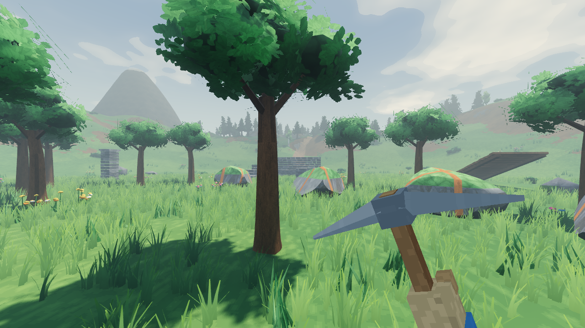

| Mining | Woodcutting | Spearfishing | Rod fishing | The pond |
|---|---|---|---|---|
| 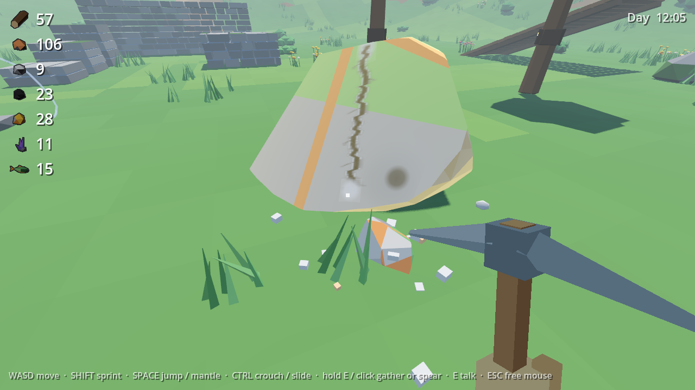 | 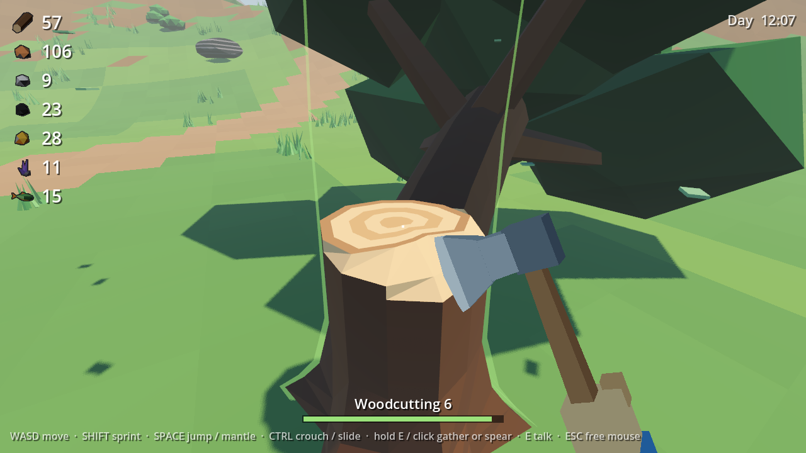 | 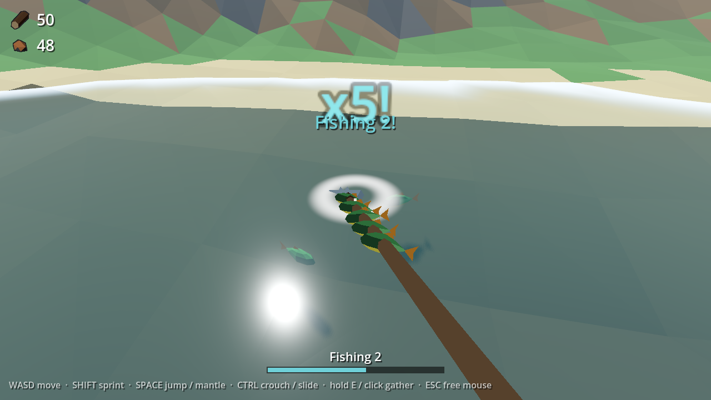 | 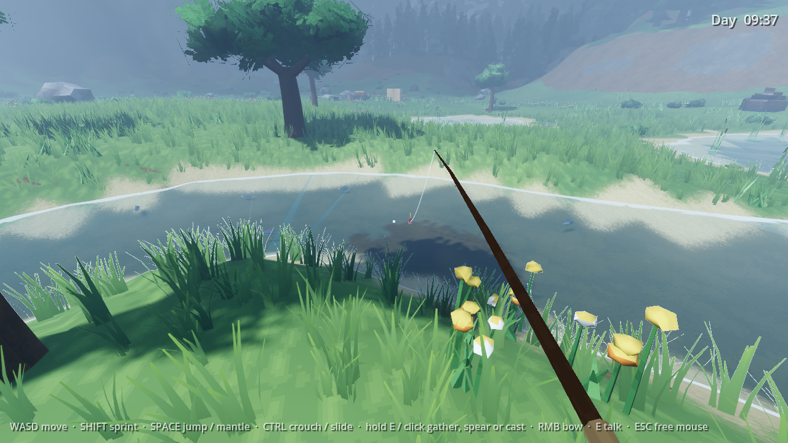 | 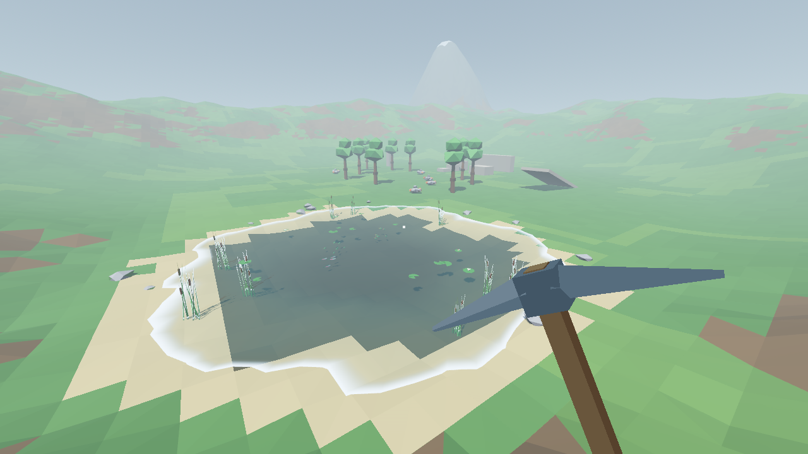 |

## Features

- **Gathering with weight.**
  - The hit lands on the swing's impact frame, not when you press the button.
  - The tool sinks into the node, holds through the hit-stop, then yanks out and tears a chunk loose.
  - During the bite, the tool really sticks in the node until you yank it out, quivering.
  - Each hit is felt: a layered sound (crack, tink, thump, a gravel trickle a beat later), chips that bounce on the ground, a dust puff, sparks, an impact star, a camera kick with a quick narrowing of the view, and pebbles piling up round the rock. Pitch rises as a node weakens.
- **Mining: rocks that break where you hit them.**
  - Every ore rock is 13 to 36 pieces that fit together exactly, weathered outside and fresh inside. Each hit knocks out the piece you struck and its nearest neighbours, showing bright stone and glinting ore. Collision follows the real shape, refitted as pieces come off.
  - Pieces rest on each other: knock out what holds one up and everything above it comes down (**Collapse!**). Once enough is gone, the rest shatters.
  - Every rock has a **fault**, a hairline crack with grit trickling out of it. Find it and hit it and a whole cluster breaks out at once (**Fault!**), then it opens up somewhere else.
  - Ore spills out of the pieces that carry a vein as you dig; the shatter pays the rest.
  - The pickaxe squares up when you look at a rock, then swings overhead and comes down pick-first on the crosshair.
- **Woodcutting: trees you notch and fell.**
  - The felling axe swings flat from the side: pulled back to the right, then across, biting level into the trunk at the crosshair.
  - Every hit carves a real notch into the trunk: a V with a sloped upper face and a flat lower one, deepest on your side, in pale cut wood. Bark flakes off round its rim. Walk round the tree and the notch widens round there.
  - Aim into the notch's mouth for a **clean cut** (an extra hit, double XP, a bigger chip and a sharp snap).
  - The canopy shakes and drops leaves with every hit. Near the end the tree sways and creaks; the last hit snaps it, it hangs on the hinge for a moment, then falls sideways to you (never onto you), toward whichever side is clear. It lands with a slump and spills logs.
  - What's left is the cut stump, growth rings and all, until the tree grows back. A half-cut tree keeps its notch through saving and loading.
  - Four trees, each its own look: a round starter tree, a slim white birch dashed with black, a broad oak on buttress roots, and a tall pine of ragged cones. The forest's background trees match them.
- **Skills and tools:** Woodcutting, Mining, Fishing and Farming, each with XP and levels.
  - **Tools decide what you can gather.** A node needs a good enough tool, or the swing bounces off ("Needs Iron pick"). Picks and axes come in stone, copper, iron and crystal, sickles in stone and copper; you start with stone and Greta forges the rest (see the village). A better tool also hits harder on everything below it, throws more sparks (white-hot from iron, violet from crystal), rings under every hit and swings heavier.
  - **Levels decide how well.** Every node and fish has a level rating. Below it you can still gather, just worse: 6% less hit power per level under (never below 40%) and tighter clean-cut, crack-tip and weak-point windows, with the rating shown in amber. Reaching up pays: +25% XP for breaking an under-levelled node, +50% for an under-levelled fish (which the spear only sometimes takes, and the rod's windows tighten for).
  - Every ore breaks its own way: **copper** is a verdigris-capped boulder that flakes away, its copper veins running through it; **iron** a cluster of basalt columns in jointed segments, so knocking out a column's foot topples it; **coal** courses of plates, dull charcoal in pale shale outside and glossy inside, that drop a layer when undercut; **gold** a brown geode, thinly veined, whose tough shell (two hits a piece) hides a quartz-rimmed gold heart; and **crystal** violet crystals in shards that snap off where struck and bring the rest of the crystal down.
  - Harder nodes (the tool that opens each, and its level rating):
    - Birch (stone axe, Woodcutting 8) grows west of the clearing.
    - Oak (copper axe, 15) grows around the village, and iron rocks (copper pick, Mining 15) sit east of the smithy. The village's top tiers ask for them.
    - Pine (iron axe, 25) is on the northern hills, coal (copper pick, Mining 20) by the pass, and gold (iron pick, 30) in the foothills of the peak. The newcomers' cottages are built from them, and the smithy and town hall want coal and gold for their top tiers.
    - Crystal (iron pick, Mining 40) grows only on the floor of Greystone Quarry. The smithy's fourth tier is forged with it.
    - Wheat (stone sickle, Farming 1) and barley (copper sickle, Farming 15) stand in Goldmeadow's crop squares. You cut them with a sickle, which comes out when you aim at grain. There's nothing to spend them on yet.
- **Spearfishing.**
  - Ponds in the clearing and the village, and a deeper lake to the south where Arctic char (Fishing 30) keep to the middle.
  - Wade into the pond and stalk wary schools of perch, trout and pike. The pike hunts too: watch it stalk the perch and lunge. Crouch to stay quiet: splashing and misses scatter them.
  - Every fish along the thrust gets skewered, and multi-catches escalate the feedback and XP ("Double!", "Triple!").
- **Rod fishing: reflexes and timing, not balancing a bar.** Aim at water beyond the spear's reach and the rod comes out; it stays in hand until the float is back. Every beat is read from the world (the float, the rod, the water, the sound), never a button prompt.
  - **Cast:** hold to swing the rod back, release on the forward stroke's whip. On it, the float lands on your aim point with a soft *plip*; off it, it scatters and sploshes, spooking fish nearby. Cast right on top of a school and it bolts anyway: lead the fish.
  - **Bite:** a real fish from the water notices the float, leaves its school and swims over. It nibbles (little twitches: fake-outs), taps twice, then takes: the float dunks with a *bloop*. Strike in that short window; strike on a nibble and it's gone. Each species has its own rhythm (trout nibble fast, pike sit still under it and slam it with no warning).
  - **Fight:** the fish pulls (hold to reel it in), runs (the line hisses: let go), shakes its head (the rod tip jerks on a beat: click on each jerk) and jumps (the water bulges, then a splash: bow with RMB). Each wrong or late answer costs one of three line notches; lose them all and it snaps. You're rooted while it's on, and the rod tugs your aim toward the fish. A pike may take a small fish off your line, and then you're fighting the pike.
  - **Land:** at your feet it flashes side-on on a rhythm: click on a flash to swing it out. **Clean** (no notch lost) and **Perfect** (clean, a perfect cast and an early strike) pay extra XP, and every fish rolls a size ("Salmon, 7.4 kg").
  - The rod owns deep and far water: **Arctic char** in the middle of the lake, and in generated worlds' rivers **grayling** (Fishing 15) holding station in the current (cast upstream and let the float drift down to them) and **salmon** (Fishing 40) in the deep pools at the bends. Pond fish bite it too. Under-levelled fish still bite, but every window is far tighter: skill can beat level.
  - Optional prompt assist (a small hint per move), off by default: debug menu, Player tab.
- **Biomes.** Each has its own ground colour, light, fog and ambience, and a title card when you arrive (the first visit says *Discovered*, and it's saved). Night still falls in all of them.
  - **The Pinewood** (north): a dense forest of about 100 pines and birches you can chop, among several hundred scenery trees you can bump into and wall-run off. A dirt trail runs from the clearing past three open glades to the ring road. Ferns, mushrooms, birdsong.
  - **Greystone Quarry** (west, past the peak): a five-level pit about 25 m deep.
    - A haul road spirals to the floor. Each wall has two three-step mantle stairs and sheer faces to wall-run.
    - Copper, iron, coal and gold on the levels, crystal on the floor glowing violet after dark.
    - A crane on the rim, scaffold steps, ladders, and haze that thickens as you go down.
  - **Goldmeadow** (south-east): rolling farmland. Crop squares of wheat and barley between dirt tracks, a windmill with turning sails (wall-run it), a fenced pasture with hay bales, a hay cart, lone oaks, and crickets.
  - **Hearthvale** (the village), **Stillwater** (the lake), **The Clearing** and **Frostpeak** have moods of their own too.
- **A main menu and your worlds.** The game opens on a menu over a slowly drifting view of the clearing's pond. **Continue** goes straight back into the world you played last (on a first launch it's **Play**, into the hand-built valley).
  - **Worlds:** every world is a card with a picture (taken when you last saved and quit), what it is, when you last played and for how long. Play, rename, duplicate (same seed and settings, fresh start) or delete one; the hand-built valley, *Hearthvale (classic)*, is always there and can only be reset. Each world has its own character, skills, inventory and village.
  - **New World:** a name, a seed (type one, any word works, or reroll), the size, resources, water and terrain, and a kind for each biome or Random, beside a map of the world that redraws as you change them.
  - **Esc pauses** (the whole world holds still): Resume, Settings, Controls, Save & Quit to Menu, Quit to Desktop.
  - **Settings:** graphics (presets and each effect), display (window, size, VSync, frame cap), audio (master, effects, ambience, footsteps) and controls (mouse sensitivity, invert Y, field of view, how much the camera kicks and shakes).

  | The main menu | New World |
  |---|---|
  | 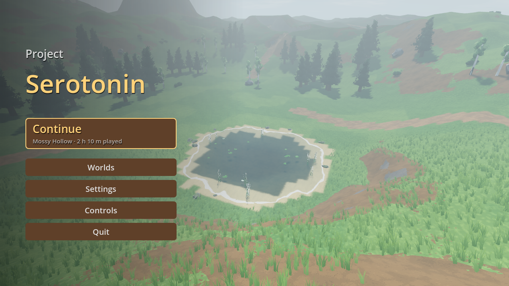 | 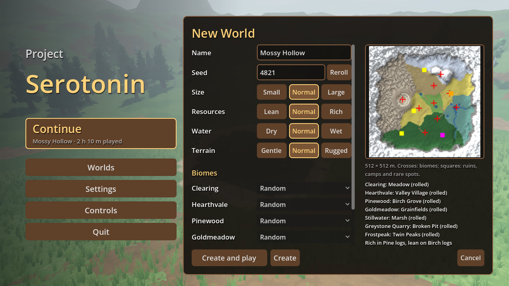 |
  | **Worlds** | **Settings** |
  | 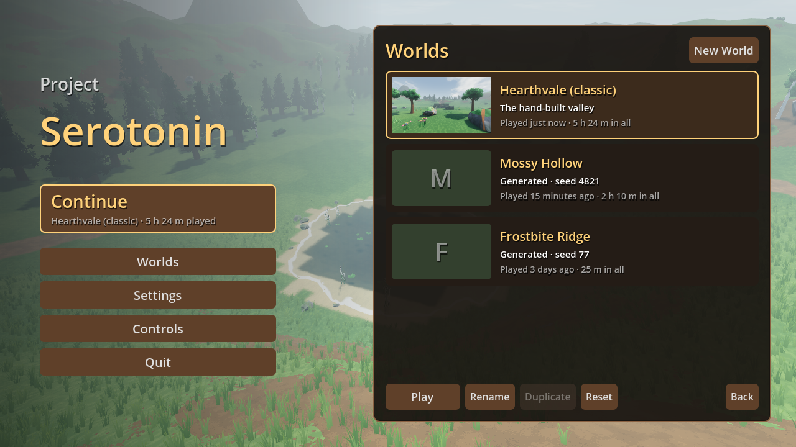 | 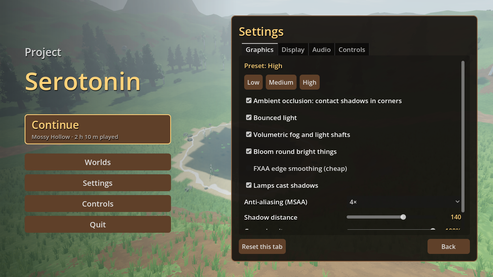 |

- **Generated worlds.** Make one from the menu's *New World* and step into a world built from a seed, behind a loading screen (about 5 s for a normal world, 20 for a large one), with its own character and save.
  - **World settings:** Small (384 m: one ring of biomes round the clearing, no Frostpeak), Normal (512 m) or Large (1 km: two more rings out to the edge, the biomes repeated with kinds you haven't seen yet); resources lean, normal or rich; water dry, normal or wet (more ponds, two rivers); terrain gentle, normal or rugged; and any biome's kind picked instead of rolled. Normal everything builds exactly what the seed always did.
  - A clearing to start in (somewhere near the middle), a ring of biomes round it with wandering borders, gentler ones near the start and harder ones further out, and mountains round the edge. Every biome is there on every seed, since progression needs them all.
  - **Every biome rolls a kind**, named on its arrival card: a Pine Forest, Birch Grove or Old Growth; Grainfields, Orchard Downs or Rolling Downs; a Great Lake, a Marsh or an Island Lake; a Terraced, Deep or Broken quarry pit; a Lone Peak, Twin Peaks or a Ridge; a Meadow or a Hollow to start in. A kind changes the ground, the trees and rocks, and the scenery.
  - **Hearthvale**, a village on every seed: the six buildings, their villagers and the upgrades (saved with that seed), round a square with lanes, in a valley or by its own pond.
  - **Water:** ponds and a lake with fish, and a river (sometimes two) winding down from the mountains into the lake; trails ford it.
  - **Out in the wilds:** ruins to climb (a Broken Tower or an Old Colonnade, an ore rock waiting on top), abandoned camps, and rare spots (a crystal outcrop or gold vein in the mountains, a ring of ancient oaks, a pond full of pike, a flower meadow).
  - **Rich and lean:** each seed has twice as much of one resource and half as much of another; the debug menu's *Procgen* tab says which.
  - Dirt trails wind from the clearing to every biome and shore. Each tree, rock, bush and boulder may be one of four baked variants of its model, so no two look alike.
  - **Every place dresses its trees and rocks** (`data/themes/`): deep moss in the Old Growth, snow caps on Frostpeak, pale dust in the quarry, sun-bleached stone and warm leaves in Goldmeadow, wet dark feet at Stillwater, gold patches in a Birch Grove or Orchard Downs. The ore, the fresh breaks and the cut wood never change, so copper always reads as copper. Rocks and trees come in eight shapes each, four families of proportions (squat or tall, lumpy or smooth, wide or narrow crowns); nodes growing close together share a family and a look, so they read as siblings. The scenery round them wears the same theme.
  - **Rare looks:** one to three nodes a seed are Ancient moss, Lightning-scorched, Frost-touched or Gilded. They glint, and give an extra drop and half as much XP again (the *Procgen* tab says where).

  | Each place's theme on the five ores (struck twice: the insides stay clean) | And on the trees |
  |---|---|
  | 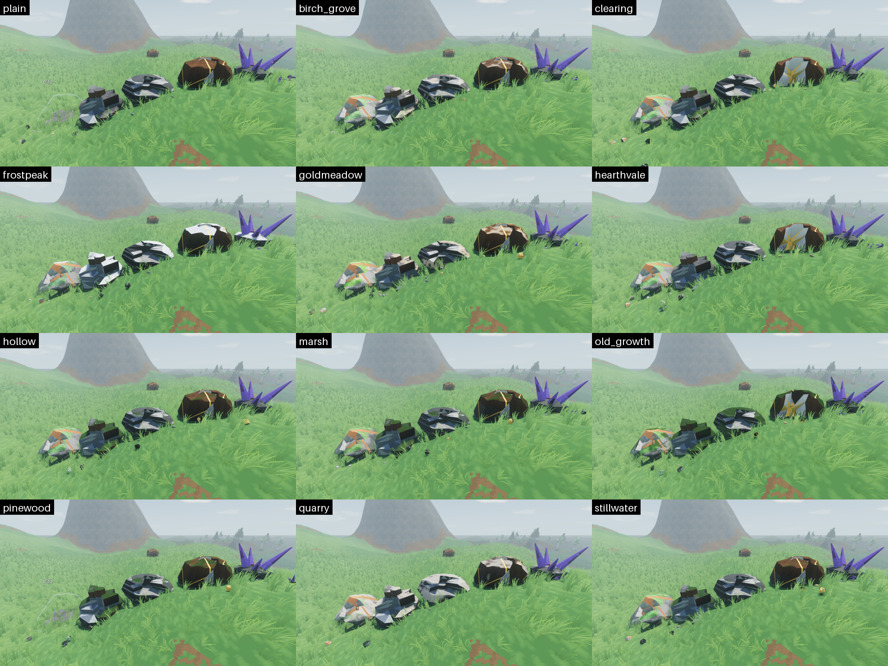 | 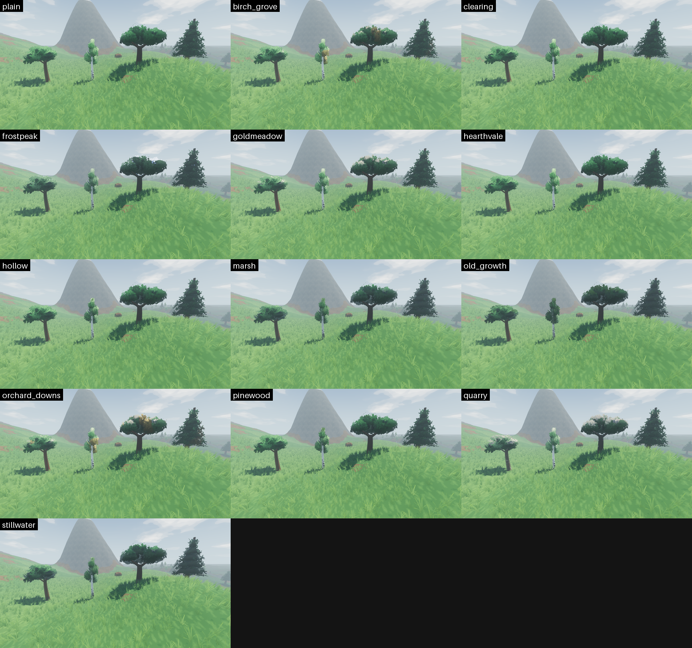 |

  | A generated world (before rivers, villages and landmarks) | Seed 42 from above (`tools/procgen_preview.gd`: ruins magenta, camps orange, rare spots yellow) |
  |---|---|
  | 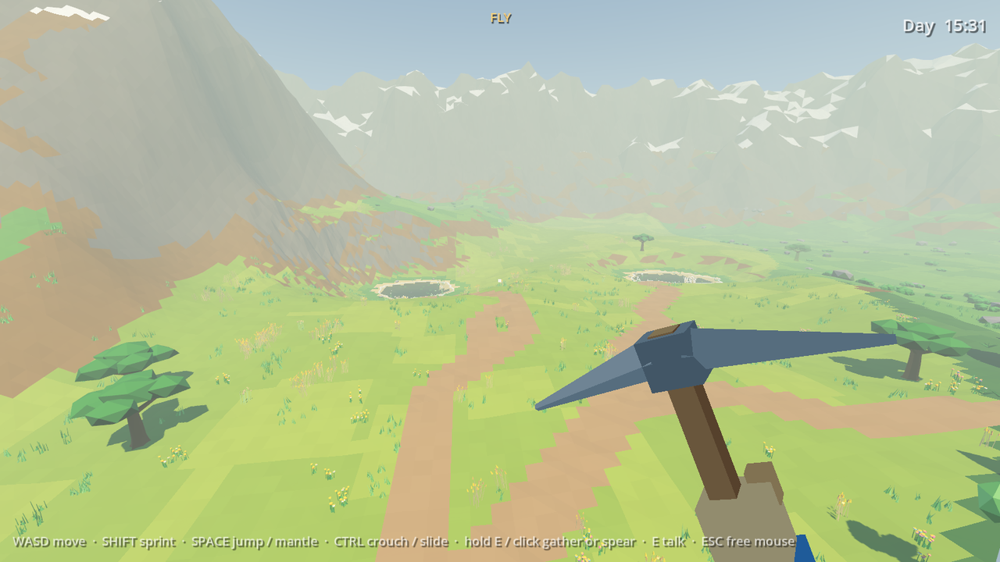 | 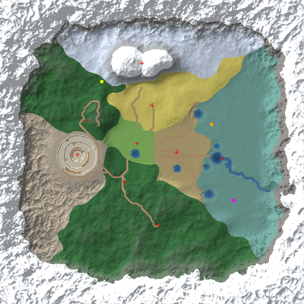 |

- **The ring road and its time trial.** A 1 km gravel loop, graded smooth, with banked bends, rock cuttings to wall-run along, spurs into every area, and a gully you can bridge or leap.
  - An obstacle course runs all the way round: log piles to hop, low walls, crate steps to mantle, wall-run panels and side-to-side alleys, ramps, low beams to slide under. Every piece leaves part of the road clear.
  - Run through the start gate (where the forest trail meets the road) and the clock starts. Pass eight checkpoint arches in order: the next one's pennants light up, and each shows your split against your best.
  - Best lap and splits are saved. Bronze, silver and gold times each hang a banner on the gate.
- **A village to build up.** Over the hills, a dirt path leads to a valley with four villagers: a woodcutter, a smith, a fisher and the mayor.
  - Talk to a villager (E) to see what their building's next tier costs, then pay with the logs, ore and fish you've gathered.
  - **Greta forges tools.** Her panel has a Forge tab: the next pick, axe and sickle, what each opens and what it costs. Each is made from what the tool before it can gather, and her smithy's tier caps the best she can make (the Stone Forge does copper, the Smithy iron, the Crystal Forge crystal).
    - Forging plays **the forge moment**: the village hushes and the view darkens round the flaring forge, Greta strikes three ringing blows, quenches the blade in a burst of steam, and the new tool is revealed in a shaft of its colour before it swings into your hands while the villagers cheer. Iron adds thunder and the town hall's bell; crystal darkens the sky and sends a violet beam up out of the anvil. E skips to the reveal.
    - Your first hit with a new tool lands with a shockwave.
  - Every building has three tiers (the smithy has a fourth, the Crystal Forge, which needs town hall tier 3). The town hall's tier caps the houses, so raising it opens the next round.
  - The village grows: raising the town hall brings new neighbours, whose cottages build themselves (Rosa the baker at tier 2, Edda the prospector at tier 3). Their cottages upgrade too: Rosa's into a bakery and bakehouse, Edda's into an assay shed and office.
  - Every tier above the first gives a perk, shown in the panel:
    - Smithy: sharper tools, so a hit can count twice. At the Crystal Forge, every 3rd hit in a row counts twice too.
    - Woodcutter: extra logs from every tree.
    - Fisher: calmer fish, then a chance of a bonus fish.
    - Town hall: bonus XP in every skill.
    - Rosa: fresh bread, so you walk and sprint faster.
    - Edda: extra ore from every rock, then rocks grow back faster.
  - Upgrades are staged: the old building collapses into dust, then the new one pops up piece by piece. The villager steps back to watch, then cheers.
  - Villagers are toy figures animated in code. They work (chopping, hammering, fishing, holding forth), wander between their spots, and turn to look at you.
- **Fast, expressive movement (Ghostrunner-ish).** Sprint, jump (with coyote time and jump buffering), crouch, slide down slopes, and mantle up ledges.
  - **Momentum:** speed above running pace bleeds off slowly instead of stopping dead.
  - **Bunny hop:** jump right as you land to keep your speed and add a little, up to 16 m/s.
  - **Slide cancel:** jump out of a slide to keep its speed. Land with crouch held and you drop straight back into a slide.
  - **Air control:** steering in the air turns you without slowing you down.
  - **Air dash:** Shift in the air, once per jump.
  - **Wall run:** jump alongside a wall at speed and run along it, then jump to kick off.
  - **Speed effects:** field of view widens, wind rises and speed lines appear as you go faster.
  - Smooth at any frame rate: physics interpolation, with the eye placed every frame.
  - Subtle feel on top: head bob, a dip when you land, a lean into strafes, and a held tool that sways with the mouse, bobs with your steps and drops out of view when you switch tools.
- **A Valheim-style look: low-poly shapes, chunky textures, heavy atmosphere.**

  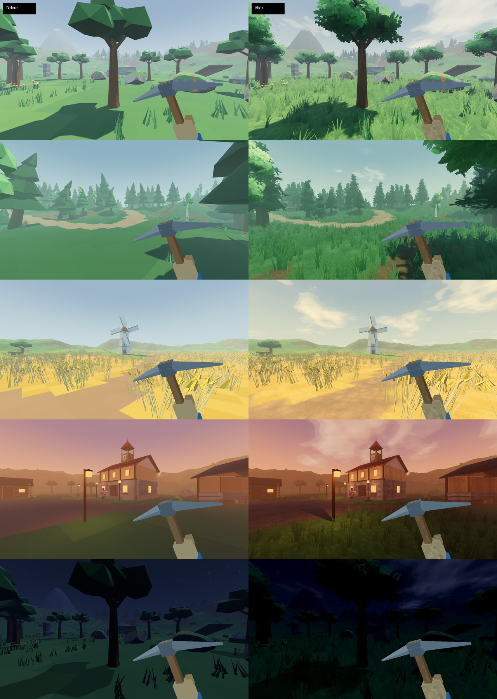

  - **Textured low-poly.** Small, pixel-crisp textures (generated by `tools/make_textures.py`) over the palette colours: stone plates, wood grain, ore speckle, leaf clumps, cloth. They're projected in each model's own space, so no model needed new UVs and the pattern sticks to things that move.
  - **Terrain:** smooth rolling ground (Terrain3D), each patch textured by what it is (grass, dirt, rock, sand, snow, forest floor, paths, the gravel road, meadow, crops, banded quarry stone), meeting in ragged, crisp borders.
  - **Leafy trees:** every crown, background tree and bush is a dark core wrapped in leaf cards (cut-out clusters of leaves or pine needles) that flutter in the wind and glow when backlit. Rocks, trunks and plants are smooth-shaded; cut faces, crystals, planks and buildings stay crisp.
  - **Dense grass** grows round you as you walk, coloured like the ground under it, swaying in the wind and parting round your legs. Flowers, bushes and boulders are scattered further out.
  - **Water** that mirrors the sky at a glance, glints in the sun, ripples, and foams at the shore; still clear enough in the shallows to see the fish.
  - **Atmosphere:** volumetric mist with light shafts (thickest at dawn and in the forest), bloom, contact shadows and bounced light, and a colour grade per biome (a green forest, a golden meadow, a cold peak) that warms at dusk and turns blue at night. Painterly clouds drift over.
  - **Graphics presets:** Low, Medium and High (or any mix) in *Settings*, saved to `user://settings.cfg`. High runs at 150–300 fps on a GTX 1080 Ti at 1280×720.
- **Day and night.** A day lasts 20 minutes: 14 of daylight, 6 of night.
  - The sun swings across the sky, and the light warms at dawn and dusk. Mornings are misty.
  - Nights are dark and moonlit blue; lamps and lanterns flicker and throw light (and, on High, shadows) round them, and windows glow.
  - Villagers go home after dark, but step out if you come to their door.
  - Fish are dozy around dawn and dusk.
- **Positional audio:** footsteps change with the surface (grass, dirt, stone, sand, snow, water; the road and quarry crunch), and the slide scrape, splashes and spear hits are placed in 3D. Mining and woodcutting sounds are synthesized (a wooden thunk, fibres snapping, the trunk creaking; a stone knock, the pick ringing, cracks running), built up in layers, each with several variations. Every tree species and every ore has its own voice: a birch rings high and short, an oak deep and long; iron rings hard, coal crumbles, crystal chimes.
- **Saving:** per world, every 30 seconds and when you quit: skills, inventory, player position, the village's tiers, the time of day, which nodes are depleted (with their respawn timers), the biomes you've discovered, and your best lap and medals.
  - Saves from before tool progression (save version 1) aren't loaded: the game renames them aside as `save.json.pre-tools.bak` (never deleted) and starts fresh. Tool scripts (`-s`) never touch an old save; they use `user://tool_run_save.json` instead.

## Playtest build

`sh tools/export/export_playtest.sh` builds `build/ProjectSerotonin-playtest.zip` for friends: the exe (game packed inside), the Terrain3D DLL it needs, and `PLAYTEST.txt` (how to run it, controls, where saves and logs go). It's a release build with the `playtest` feature (the *Windows Playtest* preset in `export_presets.cfg`), which keeps the debug menu and F-key cheats on. Needs Godot 4.7.2's export templates.

## Controls

| Action | Keys |
|---|---|
| Move / look | WASD / mouse |
| Sprint / air dash (in the air) | Shift |
| Jump / mantle (jump at a ledge while moving forward) / wall run (jump alongside a wall at speed) | Space |
| Crouch / slide (crouch while running fast, or land holding it) | Ctrl or C |
| Gather (axe, pickaxe or sickle: whichever fits what you aim at) / spear (hold) / rod: cast (hold, release on the whip), strike, reel (hold), click a headshake's jerks, land | Left mouse or E |
| Rod: bow when a hooked fish jumps | Right mouse or Q |
| Talk to a villager | E |
| Pause menu | Esc |
| Debug menu: items, skill levels, tool tiers, building tiers, time of day and speed, pause, teleports (buildings, biomes, ponds, nodes), fly mode, a live readout (with the biome), save wipe, generated worlds (enter a seed, a new random one, back to the main world), graphics presets and effects | F1 (debug builds and playtest exports) |
| Debug: skip ahead 3 hours / give 50 of every item / upgrade every building (wraps back to tier 1) | F6 / F7 / F8 (debug builds and playtest exports) |
| Debug: give XP / reset save | F9 / F10 (debug builds and playtest exports) |

## Getting started

1. Install **Godot 4.7.2** (standard build).
2. Clone the repo and open `project.godot`. The Terrain3D addon is included in `addons/terrain_3d`.
3. Press **Play** (F5). The game starts on the main menu (`scenes/menu/main_menu.tscn`).

Each world lives in its own folder, `user://worlds/<id>/` (`world.json`, `save.json`, `thumb.png`);
the hand-built world's is `user://worlds/classic/`. Saves from before the menu (`user://save.json`,
`user://procgen_<seed>.json`) move into folders on first start. Press F10 in a debug build to wipe
the current world's save. Settings live apart from the worlds, in `user://settings.cfg`.

Skip the menu from the command line (after `--`): `--classic`, `--world=<id>`, or `--procgen
[--seed=N]` (a scratch world, wiped each time). Add `--save-root=user://<dir>` to keep every world
somewhere else, as the test tools do.

## Project layout

```
addons/terrain_3d/   Terrain3D v1.0.2 (MIT) — terrain + editor tools
art/                 palette.png (+ palette.json), icons/ rendered item icons, textures/ the generated
                     detail, ground and leaf textures
audio/               sfx; footsteps/, movement/, fishing/, ambience/ are synthesized placeholders;
                     mining/ and woodcutting/ the layered gathering sounds, their sfx/ clips (mining's cut from the GDC 2026 bundle, woodcutting's synthesized)
data/biomes/         BiomeMood resources (each biome's light, ambience and card)
data/buildings/      BuildingDef resources (tiers, costs, villager lines)
data/fish/           FishSpecies resources (perch, trout, pike, char)
docs/                design notes, TODO list, README images
materials/           shared node / palette / terrain-asset materials
models/              .glb models generated by the Blender scripts (rocks, trees, tools, fish, scenery, items, village/, quarry/, field/, road/)
scenes/              main.tscn (the hand-built world), procgen.tscn (a generated one), menu/ (the main menu and its backdrop), player.tscn, resource nodes (rocks, trees, crystal, wheat, barley), pickup; village/ holds one scene per building, biomes/ the Pinewood, the quarry, Goldmeadow and the road
scripts/             gameplay code; autoload/ holds the global systems
shaders/             terrain, water, sky, grass, ripples, node surface (+ foliage, detail), fish, sway,
                     ghost outline
terrain_data/        Terrain3D region data
tools/               asset-generation scripts (see below)
```

Key scripts:
- **Player and feel:** `player.gd` (movement, per-tool swings, bite), `viewmodel.gd` (held tool), `shake_camera.gd` (shake, impact kick, FOV)
- **Gathering:** `resource_node.gd` (every tree and rock: hits, pieces knocked out where struck, collapses, faults, fitted collision, the felling), `trunk_carve.gd` (a tree's notch, carved into the trunk's mesh, and the cut through it), `hit_fx.gd` (chips, dust, sparks, impact star), `pickup.gd`, `items.gd`
- **Layered sound:** `sound_layers.gd` / `sound_layer.gd` (a sound built from timed layers), played through `Sfx`
- **Fishing:** `spear_fishing.gd`, `rod_fishing.gd` (the rod: cast, bite, fight, land), `fishing_lure.gd` (the float), `rod_cast.gd`, `fish_fight.gd`, `fish_bite.gd` (pure timing logic), `fish_pond.gd`, `fish_school.gd`, `fish.gd`, `water_body.gd`
- **Village:** `building.gd` (shows a tier, plays the upgrade), `villager.gd`, `upgrade_panel.gd`, `building_def.gd` / `building_tier.gd`, `prop.gd`
- **World:** `world_map.gd` (where the biomes, roads and landmarks are, shared with the terrain generator), `day_night_sky.gd`, `footsteps.gd`, `pond_dressing.gd`, `scenery_scatter.gd` + `scatter_layer.gd`, `node_spawner.gd` + `spawn_entry.gd` (seeded gatherable nodes with stable save ids), `windmill.gd`
- **Looks:** `grass_field.gd` (the grass round the player), `color_grade.gd` (the colour-grading table), `palette_material.gd` (plain or leaf-card material per mesh). Plan and decisions: [plans/graphics.md](plans/graphics.md)
- **Menus and worlds:** `autoload/worlds.gd` (the world folders, playing and leaving, the command line), `autoload/pause_menu.gd`, `autoload/settings.gd` (display, audio, controls), `menu/` (`main_menu.gd`, `worlds_screen.gd`, `new_world_screen.gd`, `settings_screen.gd`, `controls_screen.gd`, `loading_screen.gd`, `menu_ui.gd` the shared look). Plan and decisions: [plans/menus.md](plans/menus.md)
- **Generated worlds:** `procgen/world_settings.gd` (what a world is made from), `procgen/procgen_map.gd` (the seed's heights, surfaces, biome cells, water, quarry and trails, as plain arrays, at any size and resolution; generates on a worker thread), `procgen/procgen_world.gd` (builds `scenes/procgen.tscn` from it behind the loading screen), `procgen/procgen_population.gd` (the spawners and scenery per biome cell, by kind), `procgen/procgen_landmarks.gd` (ruins, camps, rare spots). Plans and decisions: [plans/procgen.md](plans/procgen.md), [plans/procgen-variety.md](plans/procgen-variety.md)
- **The road:** `road_course.gd` (set pieces by metres along the road), `time_trial.gd`
- **Autoloads:** `Skills`, `Tools` (the tool tiers you own, Greta's recipes), `Inventory`, `SaveGame`, `Worlds`, `PauseMenu`, `Settings`, `Village` (building tiers, the town-hall cap, perks), `DayNight` (the clock), `Biome` (where you are, the mood, cards and ambience), `GraphicsSettings` (quality presets), `Juice` (hit-stop and shake), `Sfx`, `GameInput`

## Asset pipeline

Most content is generated by scripts, so it's easy to tweak and regenerate. Run these from the project folder:

| What | Command |
|---|---|
| Palette atlas (`art/palette.png` + `.json`) | `python tools/make_palette.py` |
| Surface textures → `art/textures/` (detail per palette row, terrain ground, leaf cards; needs numpy) | `python tools/make_textures.py` |
| Low-poly models → `models/*.glb` (needs Blender 4.2+) | `blender -b -P tools/blender/make_models.py -- models art/palette.json` (add builder names such as `forest quarry farming road tool_tiers` to rebuild only those; `tool_tiers`: every tier of the forged tools into `models/tools/`) |
| Village buildings, villagers and props → `models/village/` | `blender -b -P tools/blender/make_village.py -- models art/palette.json` (or name builders, e.g. `smithy`) |
| Item icons → `art/icons/*.png` | `blender -b -P tools/blender/render_icons.py -- models art/palette.png art/icons`, then `python tools/outline_icons.py` (name item ids after either to do only those) |
| Ore design candidates → `models/designs/` (not used by the game; two looks per ore) | `blender -b -P tools/blender/make_models.py -- models art/palette.json designs` |
| Tree design candidates → `models/designs/` (two looks per tree; the picked ones also build `tree`, `birch`, `oak` and `pine`) | `blender -b -P tools/blender/make_models.py -- models art/palette.json tree_designs` |
| Model variants for generated worlds → `models/variants/` (8 of each ore rock and choppable tree over four shape families, see `recipe()`; 4 of each bush, boulder and background tree; from shifted seeds) | `blender -b -P tools/blender/make_models.py -- models art/palette.json variants` (`ore_variants` / `tree_variants`: just those) |
| Theme gallery: nodes lined up in the main world, a row per theme (`data/themes/`), on a throwaway save → `docs/images/themes/<label>.png` | `godot --path . --screen 1 -s res://tools/theme_gallery.gd -- --nodes=rock,oak_tree [--themes=plain,pinewood] [--looks] [--hit=2]` |
| A contact sheet of those, one tile per theme (or per node with `--per-node`, or a procgen seed's biomes and rare looks with `--tour SEED`) | `python tools/theme_sheet.py --godot <console exe> --nodes rock,iron_rock --label rocks [--tour 7]` (needs Pillow) |
| Close-ups of an ore rock being mined, a screenshot a hit → `docs/images/ores/<label>/` | `godot --path . -s res://tools/ore_closeup.gd -- --ore=rock [--fault] [--angle=30]` |
| Gathering sounds, woodcutting and mining → `audio/gathering/` (synthesized: every clip, plus a voice per species and ore), and the stacks the scenes play in `audio/woodcutting/` and `audio/mining/` | `python tools/synth_gathering.py` |
| Graphics tour: screenshots of fixed views (or a generated world's) and the frame rate at each, on a throwaway save | `godot --path . -s res://tools/graphics_tour.gd -- --label=NAME [--preset=high] [--only=pond,...] [--procgen=SEED]` (saves to `docs/images/graphics/NAME/`) |
| A top-down picture of a generated world (biomes, water, the quarry, trails), and how long it took | `godot --headless --path . -s res://tools/procgen_preview.gd -- --seed=42 [--seed=7 ...] [--out=dir]` |
| Screenshots of the menus (and a check of play / pause / save and quit) on a throwaway save root → `docs/images/menus/` | `godot --path . --screen 1 --resolution 1280x720 -s res://tools/menu_shots.gd -- --save-root=user://menu_shots` |
| Tests: world folders and migration; the generator (normal settings unchanged, each knob, each size); a world loading the same spread over frames | `godot --headless --path . -s res://tools/test_worlds.gd -- --save-root=user://test_worlds`, `... -s res://tools/test_generator.gd`, `... -s res://tools/test_loading.gd -- --save-root=user://test_loading` |
| Check the mining mix without listening (how loud each event comes out, and how much that varies hit to hit) | `blender -b -P tools/measure_mix.py --` |
| A listening preview of the gathering sounds (oak chopped and felled, iron and crystal mined) | `python tools/render_sound_preview.py out.wav` |
| The chop and the pickaxe blow in variants A/B/C, four blows each, to pick the closest by ear → `docs/sound_preview/compare/` | `python tools/render_sound_variants.py` |
| Record gathering sounds through the real buses (SFX's effects, then Master) and report how hard the effects squash each one | `godot --headless --path . -s res://tools/record_sfx_chain.gd -- [--out=user://sfx_chain]` |
| Check every sound stack under `audio/` loads, with no missing clips | `godot --headless --path . -s res://tools/check_sound_stacks.gd` |
| Placeholder sounds (footsteps, slide, wind, mantle, splash, spear) | `python tools/synth_movement_sounds.py` (needs numpy) |
| Rod fishing's sounds (cast whip, plip, nibble, bloop, reel, creak, hiss, jump, snap, ...) → `audio/fishing/` | `python tools/synth_fishing.py` (needs numpy) |
| Rod fishing's timing logic: bots play whole fights for every species (an answering one must land them all cleanly, a lazy one must snap) | `godot --headless --path . -s res://tools/test_fishing.gd` |
| Rod fishing end to end in the real game: a bot casts, waits for a bite, strikes, fights and lands, saving screenshots to `user://fishing_playtest/` (throwaway save) | `godot --path . --screen 1 -s res://tools/fishing_playtest.gd -- [--casts=3] [--level=30] [--procgen=SEED]` |
| The forge cutscene's sounds (flare, drone, three blows, quench hiss, reveal, thunder, bell, beam, first-swing shockwave, ...) → `audio/forge/` | `python tools/synth_forge.py` (needs numpy) |
| The forge moment in the real game: Greta forges a tool (tier 1 copper, 2 iron, 3 crystal), screenshots of every beat and the first swing after → `user://forge_playtest/` (throwaway save) | `godot --path . --screen 1 --resolution 1280x720 -s res://tools/forge_playtest.gd -- [--tier=1] [--tool=pickaxe] [--skip]` |
| Placeholder biome ambience (forest, field, quarry) | `python tools/synth_ambience.py` (needs numpy) |
| Terrain: the original layout plus the biomes and roads (**overwrites** `terrain_data/`) | `godot --headless --path . -s res://tools/generate_test_terrain.gd` (add `-- --preview=map.png` for a top-down check). It keeps the ground under hand-placed nodes as it was and reports any that moved. |

Models colour their faces by pointing UVs at palette swatches (the palette row also picks the
detail texture). Rocks, trees, plants and fish are smooth-shaded at export (`SMOOTH` in
`make_models.py`), and canopies get leaf cards (`leafy()`), marked by a second UV layer. To
hand-edit a model, import the `.glb` in Blender, edit it, and export it back as `.glb`.

## Extending

- **Placing nodes:** give every placed node its own `save_id` in the inspector. It's the key its depleted state is saved under. For many at once, use a `NodeSpawner` (see `scenes/biomes/`): it places them by seed and numbers their save ids itself.
- **Moving a biome or a road:** edit `scripts/world_map.gd` and regenerate the terrain. The spawners, scatter and road course follow the new shapes.
- **Keep node models to a few meshes.** Every mesh on the palette material uses per-instance shader slots. The global buffer for them is raised in `project.godot`, but a model of dozens of loose parts, times a field of them, still adds up.
- **A new resource node:** in Godot, right-click `scenes/resource_node.tscn` → *New Inherited Scene*. Set the item, skill and sounds, then either add meshes under `Visual/Body`, `Visual/Chunks` and `Rubble`, or set `model` to a `.glb` whose objects are named `Body_*`, `Chunk_*` and `Rubble_*`.
- **A new rock that cracks:** inherit `scenes/rock.tscn` (cracks, fitted collision, the layered sounds and hit effects are already on) and build its model with `fractured()` in `make_models.py`, like the ore rocks. That gives each `Chunk_X` a `Seam_X` line (its outline, which the crack follows) and marks the cut faces in a `cut_mark` vertex colour. Set `chip_color` to the rock's stone (cracks are drawn in it) and `ore_color` to its ore. `seam_crack_on_piece_only` keeps a crack off what surrounds the piece (the crystal rock uses it).
- **A new layered sound:** make a `SoundLayers` `.tres` (see `audio/mining/`) with a `SoundLayer` per layer (stream, delay, volume, pitch, jitter), and play it with `Sfx.play_at()` or `Sfx.play_layers()`.
- **A new item:** add a row to `Items.DEFS` (`scripts/items.gd`) and an entry to `ICONS` in `tools/blender/render_icons.py`.
- **A new fish:** add a model to the Blender script and a `FishSpecies` `.tres` in `data/fish/`, then list it in the pond's `Fish` node (`FishPond.schools`). Its *Rod*, *Fight* and *Size* groups set how it bites and fights; run `tools/test_fishing.gd` after (it checks a good player can land it).
- **A new skill:** add a row to `Skills.SKILLS` (`scripts/autoload/skills.gd`).
- **A new tool tier:** add its name to `Tools.LADDER` and its recipe to `Tools.RECIPES` (`scripts/autoload/tools.gd`), set `tool_tier` on the nodes it opens, and build its model and icon (`make_models.py` `tool_tiers`, `render_icons.py`).
- **A new village building:**
  1. Add a function to `tools/blender/make_village.py` that builds each tier's pieces with a `Kit("T1", ...)`, `Kit("T2", ...)` and so on.
  2. Add a `BuildingDef` `.tres` in `data/buildings/` with its tiers, costs and lines.
  3. Copy a scene in `scenes/village/`, then move its `Spots` markers (Door, Bench, Work1–3) to fit the new model.
- **Retuning upgrades:** costs and villager lines live in `data/buildings/*.tres`. Each tier also has an empty `effects` list, where upgrade mechanics will plug in.

## Docs

- [docs/TODO.md](docs/TODO.md): everything planned or parked for later.
- [docs/blender-guide.md](docs/blender-guide.md): remodel the rock by hand in Blender (a first modelling project).
- [docs/village-design.md](docs/village-design.md): the village design decisions.
- [docs/3d-research-notes.md](docs/3d-research-notes.md): design decisions and research notes from the 3D conversion and the fishing design.
- [plans/fishing.md](plans/fishing.md): the rod fishing design (decisions R1–R11) and how it's built.

## Credits

- [Terrain3D](https://github.com/TokisanGames/Terrain3D) by Cory Petkovsek, Roope Palmroos and contributors (MIT). `shaders/terrain.gdshader` builds on its example shader.
- Models made with [Blender](https://www.blender.org/). The game is built with [Godot](https://godotengine.org/).
- Mining sounds cut from the [Sonniss GDC 2026 Game Audio Bundle](https://sonniss.com/gameaudiogdc) (royalty free, no attribution required). Per-clip sources: `audio/mining/sfx/SOURCES.md`. The woodcutting sounds are synthesized (`audio/woodcutting/sfx/SOURCES.md`).
