# Project Serotonin

A first-person, low-poly gathering game made in **Godot 4.7**, with a Valheim-style look. Chop trees, mine rocks, cut
grain, spearfish in shallow ponds and rod-fish the lake and the creek, across a forest, a quarry, farmland and a village, in
one curated valley, Hearthvale, where every place eases into the next. The game is about how gathering *feels*: impact-frame hits,
hit-stop, screen shake, positional audio, chunks flying off nodes, and a tool that bites into
whatever you hit.


| Mining | Woodcutting | Spearfishing | Rod fishing | The pond |
|---|---|---|---|---|
|  |  |  |  |  |

## Features

- **Gathering with weight.**
  - The hit lands on the swing's impact frame, not when you press the button.
  - The tool sinks into the node, holds through the hit-stop, then yanks out and tears a chunk loose.
  - During the bite, the tool really sticks in the node until you yank it out, quivering.
  - Each hit is felt: a layered sound (crack, tink, thump, a gravel trickle a beat later), chips that bounce on the ground, a dust puff, sparks, an impact star, a camera kick with a quick narrowing of the view, and pebbles piling up round the rock. Pitch rises as a node weakens.
- **Mining: rocks that break where you hit them.**
  - Every ore rock is 13 to 36 pieces that fit together exactly, weathered outside and fresh inside. Each hit knocks out the piece you struck and its nearest neighbours, showing bright stone and glinting ore. Collision follows the real shape, refitted as pieces come off.
  - Pieces rest on each other: knock out what holds one up and everything above it comes down (**Collapse!**). Once enough is gone, the rest shatters.
  - Every rock has a **fault**, a hairline crack with grit trickling out of it. Find it and hit it and a whole cluster breaks out at once (**Fault!**), then it opens up somewhere else.
  - Ore spills out of the pieces that carry a vein as you dig; the shatter pays the rest.
  - The pickaxe squares up when you look at a rock, then swings overhead and comes down pick-first on the crosshair.
- **Woodcutting: trees you notch and fell.**
  - The felling axe swings flat from the side: pulled back to the right, then across, biting level into the trunk at the crosshair.
  - Every hit carves a real notch into the trunk: a V with a sloped upper face and a flat lower one, deepest on your side, in pale cut wood. Bark flakes off round its rim. Walk round the tree and the notch widens round there.
  - Aim into the notch's mouth for a **clean cut** (an extra hit, double XP, a bigger chip and a sharp snap).
  - The canopy shakes and drops leaves with every hit. Near the end the tree sways and creaks; the last hit snaps it, it hangs on the hinge for a moment, then falls sideways to you (never onto you), toward whichever side is clear. It lands with a slump and spills logs.
  - What's left is the cut stump, growth rings and all, until the tree grows back. A half-cut tree keeps its notch through saving and loading.
  - Four trees, each its own look: a round starter tree, a slim white birch dashed with black, a broad oak on buttress roots, and a tall pine of ragged cones. The forest's background trees match them.
- **Skills and tools:** Woodcutting, Mining, Fishing and Farming, each with XP and levels.
  - **Tools decide what you can gather.** A node needs a good enough tool, or the swing bounces off ("Needs Iron pick"). Picks and axes come in stone, copper, iron and crystal, sickles in stone and copper; you start with stone and Greta forges the rest (see the village). A better tool also hits harder on everything below it, throws more sparks (white-hot from iron, violet from crystal), rings under every hit and swings heavier.
  - **Levels decide how well.** Every node and fish has a level rating. Below it you can still gather, just worse: 6% less hit power per level under (never below 40%) and tighter clean-cut, crack-tip and weak-point windows, with the rating shown in amber. Reaching up pays: +25% XP for breaking an under-levelled node, +50% for an under-levelled fish (which, 10% per level under, dodges the spear or slips the rod's hook).
  - Every ore breaks its own way: **copper** is a verdigris-capped boulder that flakes away, its copper veins running through it; **iron** a cluster of basalt columns in jointed segments, so knocking out a column's foot topples it; **coal** courses of plates, dull charcoal in pale shale outside and glossy inside, that drop a layer when undercut; **gold** a brown geode, thinly veined, whose tough shell (two hits a piece) hides a quartz-rimmed gold heart; and **crystal** violet crystals in shards that snap off where struck and bring the rest of the crystal down.
  - Harder nodes (the tool that opens each, and its level rating):
    - Birch (stone axe, Woodcutting 8) grows west of the clearing.
    - Oak (copper axe, 15) grows around the village, and iron rocks (copper pick, Mining 15) sit east of the smithy. The village's top tiers ask for them.
    - Pine (iron axe, 25) is on the northern hills, coal (copper pick, Mining 20) by the pass, and gold (iron pick, 30) in the foothills of the peak. The newcomers' cottages are built from them, and the smithy and town hall want coal and gold for their top tiers.
    - Gold and crystal are the old Greystone mine's (below): gold from its second level down, crystal (iron pick, Mining 40) in its crystal caverns. The smithy's fourth tier is forged with crystal.
    - Wheat (stone sickle, Farming 1) and barley (copper sickle, Farming 15) stand in Goldmeadow's crop squares. You cut them with a sickle, which comes out when you aim at grain. There's nothing to spend them on yet.
- **Two ways to fish, neither stronger.** **Q** swaps the spear for the rod (and back); the one you pick takes any water it can reach. The spear is active and bursty, the rod patient and far-reaching; at the same tier and level a skilled player earns about the same either way (`tools/fishing_bench.gd` measures it).
  - **Fish come in sizes** you can see in the school. Bigger pays up to +50% XP, a **Big** one (about 1 in 8) counts as 2 fish and a **Huge** one (1 in 25) as 3.
  - **Spears and rods are forged in tiers** at Greta's, like the pick and axe: sharpened stick / willow pole (perch), copper (trout, grayling), iron (pike, char), crystal (salmon). Both tools open the same fish at the same tier. Too weak a spear glances off ("Needs Iron spear"); on the rod such fish rarely bite, and the hook tears out when they do. Each tier also adds reach (spear) or cast range and time to pull (rod).
  - Every fish can be caught both ways: Arctic char and salmon live in deep water, but come up into the shallows to feed at dawn and dusk, where you can wade out to them.
- **Spearfishing.**
  - Ponds in the clearing and the village, and a deeper lake to the south where Arctic char (Fishing 30) keep to the middle.
  - Wade into the pond and stalk wary schools of perch, trout and pike. The pike hunts too: watch it stalk the perch and lunge. Crouch to stay quiet: splashing and misses scatter them.
  - Every fish along the thrust gets skewered, and multi-catches escalate the feedback and XP ("Double!", "Triple!").
- **Rod fishing: wait for it, then pull.** With the rod picked (Q), aim at water from about 2 m out to its cast range; it stays in hand until the float is back. Every beat is read from the world (the float, the rod, the water, the sound), never a button prompt.
  - **Cast:** hold to swing the rod back, release on the forward stroke's whip. On it, the float lands on your aim point with a soft *plip*; off it, it scatters and sploshes, spooking fish nearby. Cast right on top of a school and it bolts anyway: lead the fish.
  - **Bite:** a real fish from the water notices the float, leaves its school and swims over. It nibbles (little twitches: fake-outs), taps twice, then takes: the big moment. The float is dragged under with a plunge and a bell, the water bursts, a "!" pops up and the rod bends hard. Click to pull inside that window (about half a second); pull on a nibble and it's gone, too late and it spits the hook. Each species has its own rhythm (trout nibble fast, pike sit still under it and slam it with no warning).
  - **Yank:** pull on time and the fish tears out of the water with a hit-stop and a spray, sails over in a tumbling arc on the end of the line, slaps down on the bank beside you and flops about. Walk up to it to pick it up ("Salmon, 7.4 kg"); a perfect cast plus a quick pull is **Perfect!** (+50% XP).
  - The rod reaches deep and far water from the bank: **Arctic char** in the middle of the lake. Pond fish bite it too. In the creek, **grayling** (Fishing 15) hold station in the current (cast upstream and let the float drift down to them) and **salmon** (Fishing 40) lie in its two deep pools.
- **Biomes.** Each has its own ground colour, light, fog and ambience, and a title card when you arrive (the first visit says *Discovered*, and it's saved). Night still falls in all of them.
  - **The Pinewood** (north): a dense forest of about 100 pines and birches you can chop, among several hundred scenery trees. A dirt trail runs from the clearing past three open glades into the woods, and the village road climbs in from the east. Ferns, mushrooms, birdsong.
  - **Greystone Quarry** (west, past the peak): a five-level pit about 25 m deep.
    - A haul road spirals to the floor between cut stone faces. The mountainside round it falls gently away into the hills.
    - Copper rocks up top, coal and iron further down, growing back as everywhere else.
    - A working quarry: a crane on the rim, crates and barrels, a cart on a stretch of rail, lamp posts, tools left about, ferns and flowers in the cracks, a puddle on the floor, and haze that thickens as you go down.
  - **The old Greystone mine** ([plans/mine.md](plans/mine.md)), under the quarry. Its mouth on the quarry floor is boarded up till you shore it (a noticeboard project); then three levels of tunnels lie under the pit, and you dig your way through them.
    - **Dig faces:** wherever a tunnel ends in rock there's a face of ore wall. Dig a couple of layers in (about half a minute) and the rest gives way: the next stretch of tunnel opens for good, sometimes a chamber, now and then with a fossil or a geode in it for your wall.
    - **Seams** along the open tunnels give ore and grow back after a while, so the mine stays worth a visit once it's all open. Its ore is richer than the quarry's, and it's the only place for gold and crystal.
    - **Three levels:** earthy tunnels with copper and coal; rusty rock with iron and gold, an underground stream behind a flooded tunnel; the crystal caverns, glowing softly, with gold and crystal. The rock gets harder further down (a copper pick, then an iron one).
    - **Upgrades** on the noticeboard as you find what needs them: timber supports for a roof fall, a lift down the shaft you dig into, a pump for the flood, frames and lamps for each level, and rails with a minecart: a calm ride down a long lamplit tunnel to the deepest level you've opened.
    - Down there it's dim and warm where the tunnels are shored (fresh ones get their frames the next morning: Edda sees to it overnight) and dark beyond, but for your lantern. M shows the level's map. Edda writes to you about what you find.

    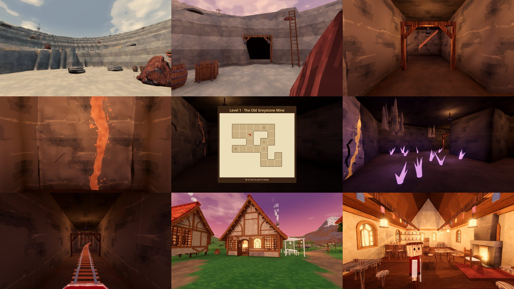
  - **Goldmeadow** (south-east): rolling farmland. Crop squares of wheat and barley between dirt tracks, a windmill with turning sails, a fenced pasture with hay bales, a hay cart, lone oaks, and crickets.
  - **Hearthvale** (the village), **Stillwater** (the lake), **The Clearing** and **Frostpeak** have moods of their own too.
- **A main menu and your worlds.** The game opens on a menu over a slowly drifting view of the clearing's pond. **Continue** goes straight back into the world you played last (on a first launch it's **Play**). There's one world, Hearthvale ([plans/world.md](plans/world.md): generated worlds were removed, and old ones are deleted on startup).
  - **Worlds:** Hearthvale's card, with a picture (taken when you last saved and quit), when you last played and for how long. Play, rename or reset it.
  - **Esc pauses** (the whole world holds still): Resume, Settings, Controls, Save & Quit to Menu, Quit to Desktop.
  - **Settings:** graphics (presets and each effect), display (window, size, VSync, frame cap), audio (master, effects, ambience, footsteps) and controls (mouse sensitivity, invert Y, field of view, how much the camera kicks and shakes).

  | The main menu | Worlds | Settings |
  |---|---|---|
  |  |  |  |

- **Every place dresses its trees and rocks** (`data/themes/`): deep moss in the Old Growth, snow caps on Frostpeak, pale dust in the quarry, sun-bleached stone and warm leaves in Goldmeadow, wet dark feet at Stillwater, gold patches in a Birch Grove or Orchard Downs. The ore, the fresh breaks and the cut wood never change, so copper always reads as copper. Rocks and trees come in eight shapes each, four families of proportions (squat or tall, lumpy or smooth, wide or narrow crowns); nodes growing close together share a family and a look, so they read as siblings. The scenery round them wears the same theme.

  | Each place's theme on the five ores (struck twice: the insides stay clean) | And on the trees |
  |---|---|
  |  |  |


- **One valley, all of a piece** ([plans/world.md](plans/world.md)). Broad rolling hills ease down into the clearing, the village and the lake basin, joined by shallow valleys; nothing outside the quarry's stone faces is sheer, and almost all of it is gentler than 30°. The world's edge rises into high hills, so the valley feels closed in rather than cut off. Biomes fray into the grass at their edges instead of ending on a line.
  - **The creek** runs from a spring at the foot of the Pinewood hills, down its own little vale, through the clearing's pond and into the lake. Wade it anywhere; mend the footbridge where the village path crosses it.
  - **Roads that follow the land:** gravel roads to the quarry, round the lake, to Goldmeadow and from the village up into the Pinewood, and dirt paths to the lake, into the forest and up Frostpeak. Each was routed over the terrain the cheapest way (round hills, along valleys) and climbs gently.

  | The land's slopes before (black: sheer) | And after |
  |---|---|
  | 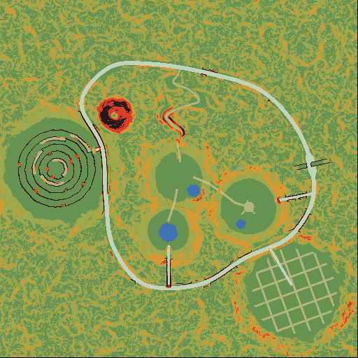 | 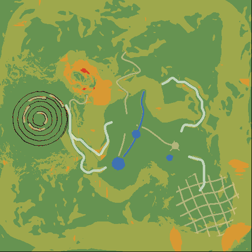 |

  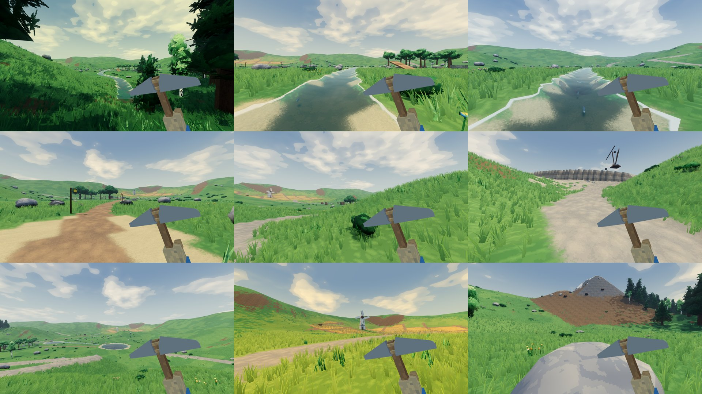
  (`graphics_tour.gd -- --set=world`; the world map: [docs/images/world/classic_map.png](docs/images/world/classic_map.png))
- **Your dog** ([plans/dog.md](plans/dog.md)). On your first morning three strays nap by the clearing's pond: a scruffy terrier, a shepherd mutt and a big fluffy one. Pet one (E), name him and pick his coat, and he's yours.
  - He follows you at an easy distance, trots ahead on roads and paths, sits when you stop, lies down while you gather (never in front of what you're hitting), and sniffs about. Fall far behind and he trots up from out of view.
  - Pet him any time (E). He paddles after you into shallow water, waits on the bank where it's deep, and shakes himself dry. While you fish he watches the float.
  - At night he carries your lantern in his mouth, a little ahead of you, lighting the way (hold the raise key to take it back). Stand still and he dozes at your feet.
  - Now and then he shows you something: an ore fault or a rare node to sniff at, a fish school to stare at. A big catch gets a happy wiggle; a far-off wolf gets an answer. He pants as he trots, sniffs, whines happily when petted and gives a soft woof now and then (real recordings, pitched higher for the terrier, lower for the big one).
  - **His doghouse** is three projects on the noticeboard, one after another: a kennel, then paint and his name on a sign, then a porch, a bowl and a blanket. He sleeps in its doorway at night when you're in the village and waits there in the morning.

  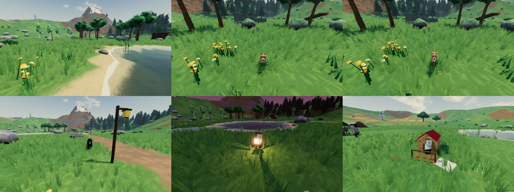

- **The road east, the market and the trader** ([plans/market.md](plans/market.md)). A road climbs from the village through a pass in the eastern hills, but a landslide has buried it partway up.
  - Break its boulders with your pick (they never grow back), then pay for a timber retaining wall on the noticeboard: the mud goes and the road is open.
  - **The market stall** (a noticeboard project, west of the square): barter, no money. Pick what you want, then what you'll give; swaps within a family (logs, ore, crops, fish) are cheaper.
  - **The trader** drives her horse and cart over the pass every second morning once the road's open, parks by the stall (kinder rates all day) and leaves at dusk. She brings one special of each kind per visit, in turn: a collar or bandana for your dog, a decoration (hanging flower baskets, a turning weathervane, a painted cart), or a colour of lantern glass.

  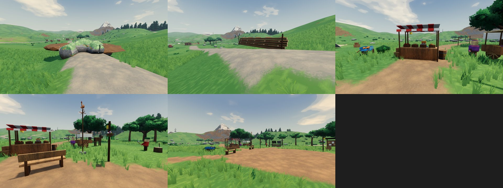

- **The villagers' day and the Sleepy Hound** ([plans/tavern.md](plans/tavern.md)). Villagers keep a day now: breakfast, work, the square at dusk, the tavern after dark, then home to bed, staggered so they never move as a herd. Each has a quirk or two (Ollie fishes at dawn, the mayor strolls round the square, Greta skips the tavern some nights). They walk the lanes, not through houses, and their windows light up when they get home and go dark one by one at bedtime.
  - **Rosa's bakery terrace** (a noticeboard project, town hall tier 2): tables under a striped awning where the village has breakfast while Rosa serves.
  - **The tavern** stands boarded up on the west of the square. Talk to Maud, its keeper, to restore it in three tiers: a taproom, then a fireplace and a stage (Ollie fiddles of an evening, and the background music holds off near it), then the full Sleepy Hound, a long timbered hall with bunting and room to dance. It's open from dark to about one in the morning, and you can walk right in. Its add-ons: a beer garden or a bigger stage, then a fireside snug or a guest room.
  - **Sit down** on any free seat (E): benches, the terrace, the tavern's stools. A movement key stands you up.
  - **Dice:** sit at the tavern's dice table of an evening and a villager comes over to play Hound's Luck. Roll five dice; 1s and 5s and three of a kind score and are set aside; roll the rest or stop and bank, but a roll that scores nothing loses the turn. First to 2000. It's played for fun: a chalkboard keeps the tally against each villager.

  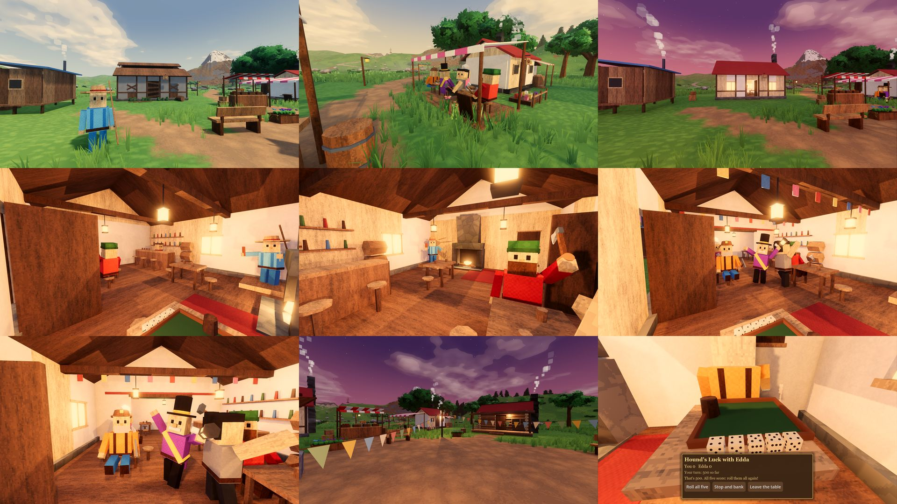

- **A village to build up.** East of the clearing, a dirt path leads along a shallow valley to the village and its four villagers: a woodcutter, a smith, a fisher and the mayor.
  - Talk to a villager (E) to see what their building's next tier costs, then pay with the logs, ore and fish you've gathered.
  - **Greta forges tools.** Her panel has a Forge tab: the next pick, axe and sickle, what each opens and what it costs. Each is made from what the tool before it can gather, and her smithy's tier caps the best she can make (the Stone Forge does copper, the Smithy iron, the Crystal Forge crystal).
    - Forging plays **the forge moment**: the village hushes and the view darkens round the flaring forge, Greta strikes three ringing blows, quenches the blade in a burst of steam, and the new tool is revealed in a shaft of its colour before it swings into your hands while the villagers cheer. Iron adds thunder and the town hall's bell; crystal darkens the sky and sends a violet beam up out of the anvil. E skips to the reveal.
    - Your first hit with a new tool lands with a shockwave.
  - Every building has three tiers (the smithy has a fourth, the Crystal Forge, which needs town hall tier 3). The town hall's tier caps the houses, so raising it opens the next round.
  - The village grows: raising the town hall brings new neighbours, whose cottages build themselves (Rosa the baker at tier 2, Edda the prospector at tier 3). Their cottages upgrade too: Rosa's into a bakery and bakehouse, Edda's into an assay shed and office.
  - Every tier above the first gives a perk, shown in the panel:
    - Smithy: sharper tools, so a hit can count twice. At the Crystal Forge, every 3rd hit in a row counts twice too.
    - Woodcutter: extra logs from every tree.
    - Fisher: calmer fish, then a chance of a bonus fish.
    - Town hall: bonus XP in every skill.
    - Rosa: fresh bread, so you walk and sprint faster.
    - Edda: extra ore from every rock, then rocks grow back faster.
  - Upgrades are staged: the old building collapses into dust, then the new one pops up piece by piece. The villager steps back to watch, then cheers.
  - Villagers are toy figures animated in code. They work (chopping, hammering, fishing, holding forth), wander between their spots, and turn to look at you.
- **Your home, and houses you can walk into** ([plans/home.md](plans/home.md)).

  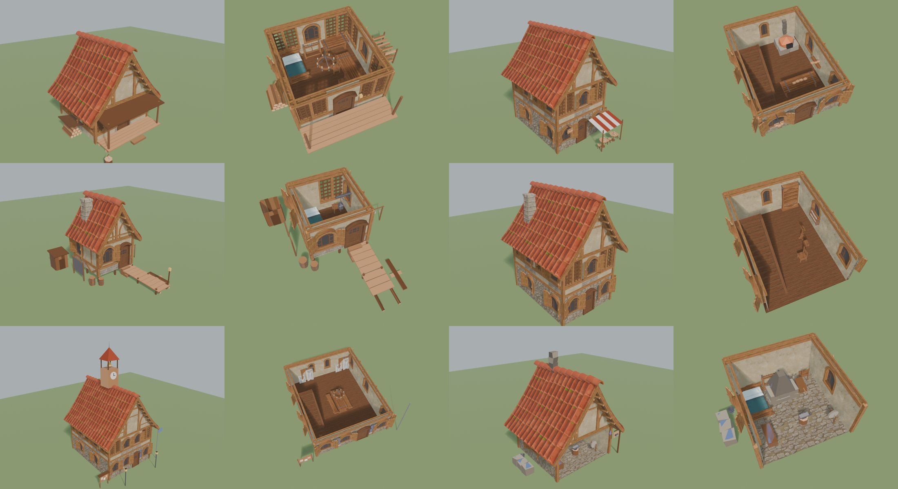

  - **Your home** starts as a tent on the village's west rim, facing the sunsets, and new games begin beside it. Its plans (E) open the usual upgrade panel: Tent, Cabin, Cottage, Homestead.

    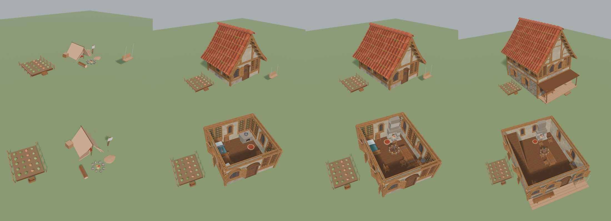

  - **Sleep:** the tent's bedroll after midnight, a real bed from dusk, never by day. The night passes honestly (the clock jumps to first light, regrowth moves on by the same time), the game saves, and you wake by the bed with the dog. From the Cottage, a full night leaves you **well rested** (+15% XP till noon), and some mornings a villager has left **a note on your desk**: a thank-you, a hint at what they'd like to build next, or a little gift. From the Homestead you can **head home** from the world map of an evening.
  - **The trophy wall** ([plans/trophies.md](plans/trophies.md)): rare finds you carry home and hang yourself, keepsakes with no perks: a trophy log, every Huge fish (mounted, per species), a geode from the richer veins, a golden sheaf, an eagle's feather lying in Frostpeak's snow, a big shell on Stillwater's shore some mornings, and the stick your dog brings you. Each keeps a brass label (what, where, which day). E on a plaque to hang, swap or take one down; the Homestead adds a mantel for the small ones. Visitors remark on what's new, and a full wall earns a framed note from the mayor.

    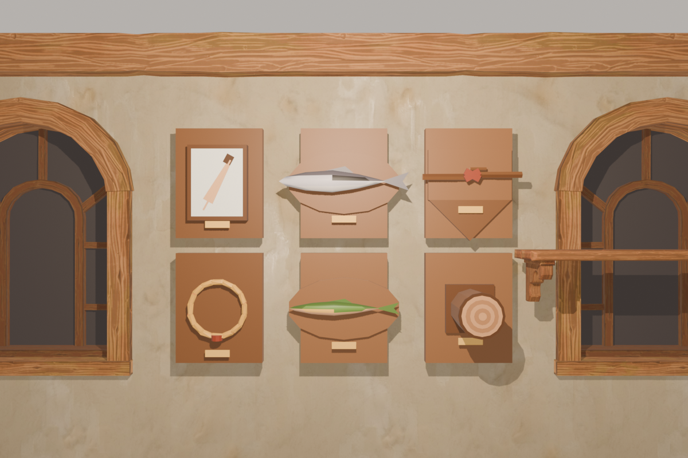

  - **The dog** sleeps on his fur patch by the fire, then in his basket by the stove.
  - **Villagers come to you:** every few days one walks over to see how the place is coming on (and says so, the first time they see a new tier); if you're out, they leave a gift on the step. Some evenings one sits on your porch before the tavern.
  - **Every house can be entered**, built from Quaternius' CC0 Medieval Village and Fantasy Props kits in their own colours: a room that grows with the tier, furniture, chairs to sit on, and a few things to look at (E: a line in the villager's voice). Villagers come home at dusk, sit by the fire till their lamp goes out, then climb the stair to bed and sleep in sight behind a shut door.
  - **Add-ons:** from the second tier, a building's slot offers a fork of two add-ons with different effects (a drying rack or a sharpening bench at the lodge, a smokehouse or a lookout perch at the fisher's...), and its top tier opens a second slot with another fork. Build one from the upgrade panel's Add-ons tab, swap later for the other's cost. Your home's: a porch swing (the day goes by faster while you sit) or a garden (a harvest every morning), then a reading nook or a hearth. Many of the second forks help in the mine (a timber slide, a tool rack, Rosa's pasties, the prospector's ore cart, lamp room, assay table and survey board).

    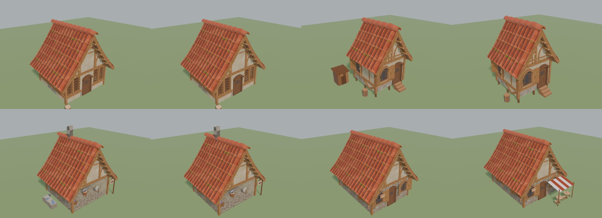
- **Fast, expressive movement (Ghostrunner-ish).** Sprint, jump (with coyote time and jump buffering), crouch, slide down slopes, and mantle up ledges.
  - **Momentum:** speed above running pace bleeds off slowly instead of stopping dead.
  - **Bunny hop:** jump right as you land to keep your speed and add a little, up to 16 m/s.
  - **Slide cancel:** jump out of a slide to keep its speed. Land with crouch held and you drop straight back into a slide.
  - **Air control:** steering in the air turns you without slowing you down.
  - **Air dash:** Shift in the air, once per jump.
  - **Wall run:** jump alongside a wall at speed and run along it, then jump to kick off.
  - **Speed effects:** field of view widens, wind rises and speed lines appear as you go faster.
  - Smooth at any frame rate: physics interpolation, with the eye placed every frame.
  - Subtle feel on top: head bob, a dip when you land, a lean into strafes, and a held tool that sways with the mouse, bobs with your steps and drops out of view when you switch tools.
- **A Valheim-style look: low-poly shapes, chunky textures, heavy atmosphere.**

  

  - **Textured low-poly.** Small, pixel-crisp textures (generated by `tools/make_textures.py`) over the palette colours: stone plates, wood grain, ore speckle, leaf clumps, cloth. They're projected in each model's own space, so no model needed new UVs and the pattern sticks to things that move.
  - **Terrain:** smooth rolling ground (Terrain3D), each patch textured by what it is (grass, dirt, rock, sand, snow, forest floor, paths, the gravel road, meadow, crops, banded quarry stone), meeting in ragged, crisp borders.
  - **Leafy trees:** every crown, background tree and bush is a dark core wrapped in leaf cards (cut-out clusters of leaves or pine needles) that flutter in the wind and glow when backlit. Rocks, trunks and plants are smooth-shaded; cut faces, crystals, planks and buildings stay crisp.
  - **Dense grass** grows round you as you walk, coloured like the ground under it, swaying in the wind and parting round your legs. Flowers, bushes and boulders are scattered further out.
  - **Water** that mirrors the sky at a glance, glints in the sun, ripples, and foams at the shore; still clear enough in the shallows to see the fish.
  - **Atmosphere:** volumetric mist with light shafts (thickest at dawn and in the forest), bloom, contact shadows and bounced light, and a colour grade per biome (a green forest, a golden meadow, a cold peak) that warms at dusk and turns blue at night. Painterly clouds drift over.
  - **Graphics presets:** Low, Medium and High (or any mix) in *Settings*, saved to `user://settings.cfg`. High runs at 150–300 fps on a GTX 1080 Ti at 1280×720.
- **Day and night.** A day lasts 20 minutes: 14 of daylight, 6 of night.
  - The sun swings across the sky, and the light warms at dawn and dusk. Mornings are misty.
  - Nights are dark and moonlit blue; lamps and lanterns flicker and throw light (and, on High, shadows) round them, and windows glow.
  - Villagers go home after dark and go to bed in sight; knock and they come to the door.
  - Fish are dozy around dawn and dusk.
- **Positional audio:** footsteps change with the surface (grass, dirt, stone, sand, snow, water; the road and quarry crunch), and the slide scrape, splashes and spear hits are placed in 3D. Mining and woodcutting sounds are synthesized (a wooden thunk, fibres snapping, the trunk creaking; a stone knock, the pick ringing, cracks running), built up in layers, each with several variations. Every tree species and every ore has its own voice: a birch rings high and short, an oak deep and long; iron rings hard, coal crumbles, crystal chimes.
- **Saving:** per world, every 30 seconds and when you quit: skills, inventory, player position, the village's tiers, the time of day, which nodes are depleted (with their respawn timers), the biomes you've discovered, and your best lap and medals.
  - Saves from before tool progression (save version 1) aren't loaded: the game renames them aside as `save.json.pre-tools.bak` (never deleted) and starts fresh. Tool scripts (`-s`) never touch an old save; they use `user://tool_run_save.json` instead.

## Playtest build

`sh tools/export/export_playtest.sh` builds `build/ProjectSerotonin-playtest.zip` for friends: the exe (game packed inside), the Terrain3D DLL it needs, and `PLAYTEST.txt` (how to run it, controls, where saves and logs go). It's a release build with the `playtest` feature (the *Windows Playtest* preset in `export_presets.cfg`), which keeps the debug menu and F-key cheats on. Needs Godot 4.7.2's export templates.

## Controls

| Action | Keys |
|---|---|
| Move / look | WASD / mouse |
| Sprint / air dash (in the air) | Shift |
| Jump / mantle (jump at a ledge while moving forward) / wall run (jump alongside a wall at speed) | Space |
| Crouch / slide (crouch while running fast, or land holding it) | Ctrl or C |
| Gather (axe, pickaxe or sickle: whichever fits what you aim at) / spear (hold) / rod: cast (hold, release on the whip), then click when the float goes under | Left mouse or E |
| Swap the fishing tool: spear / rod | Q |
| Rod: bow when a hooked fish jumps | Right mouse or Q |
| Talk to a villager / sit down on a free seat (any movement key stands you up) | E |
| Pause menu | Esc |
| Debug menu: items, skill levels, tool tiers, building tiers, time of day and speed, pause, teleports (buildings, biomes, ponds, nodes), fly mode, a live readout (with the biome), save wipe, graphics presets and effects | F1 (debug builds and playtest exports) |
| Debug: skip ahead 3 hours / give 50 of every item / upgrade every building (wraps back to tier 1) | F6 / F7 / F8 (debug builds and playtest exports) |
| Debug: give XP / reset save | F9 / F10 (debug builds and playtest exports) |

## Getting started

1. Install **Godot 4.7.2** (standard build).
2. Clone the repo and open `project.godot`. The Terrain3D addon is included in `addons/terrain_3d`.
3. Press **Play** (F5). The game starts on the main menu (`scenes/menu/main_menu.tscn`).

Each world lives in its own folder, `user://worlds/<id>/` (`world.json`, `save.json`, `thumb.png`);
the hand-built world's is `user://worlds/classic/`. A save from before the menu (`user://save.json`)
moves into its folder on first start. Press F10 in a debug build to wipe
the current world's save. Settings live apart from the worlds, in `user://settings.cfg`.

Skip the menu from the command line (after `--`): `--classic` or `--world=<id>`. Add `--save-root=user://<dir>` to keep every world
somewhere else, as the test tools do.

## Project layout

```
addons/terrain_3d/   Terrain3D v1.0.2 (MIT) — terrain + editor tools
art/                 palette.png (+ palette.json), icons/ rendered item icons, textures/ the generated
                     detail, ground and leaf textures
audio/               sfx; footsteps/, movement/, fishing/, ambience/ are synthesized placeholders;
                     mining/ and woodcutting/ the layered gathering sounds, their sfx/ clips (mining's cut from the GDC 2026 bundle, woodcutting's synthesized)
data/biomes/         BiomeMood resources (each biome's light, ambience and card)
data/buildings/      BuildingDef resources (tiers, costs, villager lines)
data/fish/           FishSpecies resources (perch, trout, pike, char)
docs/                design notes, TODO list, README images
materials/           shared node / palette / terrain-asset materials
models/              .glb models generated by the Blender scripts (rocks, trees, tools, fish, scenery, items, village/, quarry/, field/, road/)
scenes/              main.tscn (Hearthvale, the world), menu/ (the main menu and its backdrop), player.tscn, resource nodes (rocks, trees, crystal, wheat, barley), pickup; village/ holds one scene per building, biomes/ the Pinewood, the quarry, Goldmeadow and the road
scripts/             gameplay code; autoload/ holds the global systems
shaders/             terrain, water, sky, grass, ripples, node surface (+ foliage, detail), fish, sway,
                     ghost outline
terrain_data/        Terrain3D region data
tools/               asset-generation scripts (see below)
```

Key scripts:
- **Player and feel:** `player.gd` (movement, per-tool swings, bite), `viewmodel.gd` (held tool), `shake_camera.gd` (shake, impact kick, FOV)
- **Gathering:** `resource_node.gd` (every tree and rock: hits, pieces knocked out where struck, collapses, faults, fitted collision, the felling), `trunk_carve.gd` (a tree's notch, carved into the trunk's mesh, and the cut through it), `hit_fx.gd` (chips, dust, sparks, impact star), `pickup.gd`, `items.gd`
- **Layered sound:** `sound_layers.gd` / `sound_layer.gd` (a sound built from timed layers), played through `Sfx`
- **Fishing:** `spear_fishing.gd`, `rod_fishing.gd` (the rod: cast, bite, yank), `fishing_lure.gd` (the float), `landed_fish.gd` (a caught fish flying out and flopping on the bank), `rod_cast.gd`, `fish_bite.gd`, `fish_size.gd` (pure logic), `fish_pond.gd`, `fish_school.gd`, `fish.gd`, `water_body.gd`
- **Village:** `building.gd` (shows a tier, plays the upgrade), `villager.gd`, `upgrade_panel.gd`, `building_def.gd` / `building_tier.gd`, `prop.gd`
- **World:** `world_map.gd` (where the biomes, roads and landmarks are, shared with the terrain generator), `day_night_sky.gd`, `footsteps.gd`, `pond_dressing.gd`, `scenery_scatter.gd` + `scatter_layer.gd`, `node_spawner.gd` + `spawn_entry.gd` (seeded gatherable nodes with stable save ids), `windmill.gd`
- **Looks:** `grass_field.gd` (the grass round the player), `color_grade.gd` (the colour-grading table), `palette_material.gd` (plain or leaf-card material per mesh). Plan and decisions: [plans/graphics.md](plans/graphics.md)
- **Menus and worlds:** `autoload/worlds.gd` (the world folders, playing and leaving, the command line), `autoload/pause_menu.gd`, `autoload/settings.gd` (display, audio, controls), `menu/` (`main_menu.gd`, `worlds_screen.gd`, `new_world_screen.gd`, `settings_screen.gd`, `controls_screen.gd`, `loading_screen.gd`, `menu_ui.gd` the shared look). Plan and decisions: [plans/menus.md](plans/menus.md)
- **The road:** `road_course.gd` (set pieces by metres along the road), `time_trial.gd`
- **Autoloads:** `Skills`, `Tools` (the tool tiers you own, Greta's recipes), `Inventory`, `SaveGame`, `Worlds`, `PauseMenu`, `Settings`, `Village` (building tiers, the town-hall cap, perks), `DayNight` (the clock), `Biome` (where you are, the mood, cards and ambience), `GraphicsSettings` (quality presets), `Juice` (hit-stop and shake), `Sfx`, `GameInput`

## Asset pipeline

Most content is generated by scripts, so it's easy to tweak and regenerate. Run these from the project folder:

| What | Command |
|---|---|
| Palette atlas (`art/palette.png` + `.json`) | `python tools/make_palette.py` |
| Surface textures → `art/textures/` (detail per palette row, terrain ground, leaf cards; needs numpy) | `python tools/make_textures.py` |
| Low-poly models → `models/*.glb` (needs Blender 4.2+) | `blender -b -P tools/blender/make_models.py -- models art/palette.json` (add builder names such as `forest quarry farming road tool_tiers` to rebuild only those; `tool_tiers`: every tier of the forged tools into `models/tools/`) |
| Village buildings, villagers and props → `models/village/` | `blender -b -P tools/blender/make_village.py -- models art/palette.json` (or name builders, e.g. `smithy`) |
| Item icons → `art/icons/*.png` | `blender -b -P tools/blender/render_icons.py -- models art/palette.png art/icons`, then `python tools/outline_icons.py` (name item ids after either to do only those) |
| Ore design candidates → `models/designs/` (not used by the game; two looks per ore) | `blender -b -P tools/blender/make_models.py -- models art/palette.json designs` |
| Tree design candidates → `models/designs/` (two looks per tree; the picked ones also build `tree`, `birch`, `oak` and `pine`) | `blender -b -P tools/blender/make_models.py -- models art/palette.json tree_designs` |
| Model variants → `models/variants/` (8 of each ore rock and choppable tree over four shape families, see `recipe()`; 4 of each bush, boulder and background tree; from shifted seeds) | `blender -b -P tools/blender/make_models.py -- models art/palette.json variants` (`ore_variants` / `tree_variants`: just those) |
| Theme gallery: nodes lined up in the main world, a row per theme (`data/themes/`), on a throwaway save → `docs/images/themes/<label>.png` | `godot --path . --screen 1 -s res://tools/theme_gallery.gd -- --nodes=rock,oak_tree [--themes=plain,pinewood] [--looks] [--hit=2]` |
| A contact sheet of those, one tile per theme (or per node with `--per-node`) | `python tools/theme_sheet.py --godot <console exe> --nodes rock,iron_rock --label rocks` (needs Pillow) |
| Close-ups of an ore rock being mined, a screenshot a hit → `docs/images/ores/<label>/` | `godot --path . -s res://tools/ore_closeup.gd -- --ore=rock [--fault] [--angle=30]` |
| Gathering sounds, woodcutting and mining → `audio/gathering/` (synthesized: every clip, plus a voice per species and ore), and the stacks the scenes play in `audio/woodcutting/` and `audio/mining/` | `python tools/synth_gathering.py` |
| Graphics tour: screenshots of fixed views and the frame rate at each, on a throwaway save | `godot --path . -s res://tools/graphics_tour.gd -- --label=NAME [--preset=high] [--only=pond,...] ` (saves to `docs/images/graphics/NAME/`) |
| Screenshots of the menus (and a check of play / pause / save and quit) on a throwaway save root → `docs/images/menus/` | `godot --path . --screen 1 --resolution 1280x720 -s res://tools/menu_shots.gd -- --save-root=user://menu_shots` |
| Tests: world folders and migration; the generator (normal settings unchanged, each knob, each size); a world loading the same spread over frames | `godot --headless --path . -s res://tools/test_worlds.gd -- --save-root=user://test_worlds`, `... -s res://tools/test_generator.gd`, `... -s res://tools/test_loading.gd -- --save-root=user://test_loading` |
| Check the mining mix without listening (how loud each event comes out, and how much that varies hit to hit) | `blender -b -P tools/measure_mix.py --` |
| A listening preview of the gathering sounds (oak chopped and felled, iron and crystal mined) | `python tools/render_sound_preview.py out.wav` |
| The chop and the pickaxe blow in variants A/B/C, four blows each, to pick the closest by ear → `docs/sound_preview/compare/` | `python tools/render_sound_variants.py` |
| Record gathering sounds through the real buses (SFX's effects, then Master) and report how hard the effects squash each one | `godot --headless --path . -s res://tools/record_sfx_chain.gd -- [--out=user://sfx_chain]` |
| Check every sound stack under `audio/` loads, with no missing clips | `godot --headless --path . -s res://tools/check_sound_stacks.gd` |
| Placeholder sounds (footsteps, slide, wind, mantle, splash, spear) | `python tools/synth_movement_sounds.py` (needs numpy) |
| Rod fishing's sounds (cast whip, plip, nibble, bloop, reel, creak, hiss, jump, snap, ...) → `audio/fishing/` | `python tools/synth_fishing.py` (needs numpy) |
| Fishing's pure logic: the cast's judging, level scaling and catch chance, sizes, every species' strike window and bite rhythm | `godot --headless --path . -s res://tools/test_fishing.gd` |
| Spear vs rod balance: a bot fishes the same water with each tool for a few game minutes and prints fish and XP per minute (throwaway save, fresh world per run) | `godot --path . --screen 1 -s res://tools/fishing_bench.gd -- [--minutes=4] [--level=30] [--tier=3] [--water=0,1]` |
| Rod fishing end to end in the real game: a bot casts, waits for a bite, pulls, and picks up the fish where it lands, saving screenshots to `user://fishing_playtest/` (throwaway save) | `godot --path . --screen 1 -s res://tools/fishing_playtest.gd -- [--casts=3] [--level=30]` |
| The forge cutscene's sounds (flare, drone, three blows, quench hiss, reveal, thunder, bell, beam, first-swing shockwave, ...) → `audio/forge/` | `python tools/synth_forge.py` (needs numpy) |
| The forge moment in the real game: Greta forges a tool (tier 1 copper, 2 iron, 3 crystal), screenshots of every beat and the first swing after → `user://forge_playtest/` (throwaway save) | `godot --path . --screen 1 --resolution 1280x720 -s res://tools/forge_playtest.gd -- [--tier=1] [--tool=pickaxe] [--skip]` |
| Placeholder biome ambience (forest, field, quarry) | `python tools/synth_ambience.py` (needs numpy) |
| Terrain: the original layout plus the biomes and roads (**overwrites** `terrain_data/`) | `godot --headless --path . -s res://tools/generate_test_terrain.gd` (add `-- --preview=map.png` for a top-down check). It keeps the ground under hand-placed nodes as it was and reports any that moved. |

| Kit pieces into `art/kit/` (Quaternius CC0 packs, textures as 1024 px JPEGs) | `python tools/import_kit.py village <kit glTF dir>`, `python tools/import_kit.py props <props glTF dir>` |
| The houses built from the kit → `models/village/<name>.gltf` (shared textures in `models/village/textures/`): the village's six houses, your home, their add-ons | `blender -b -P tools/blender/kit_buildings.py -- models art/palette.json [baker_cottage woodcutter fisher prospector_cottage town_hall smithy home]` |
| Trophy models → `models/trophies/` (the picked looks; `both` for the a/b looks) | `blender -b -P tools/blender/make_trophies.py -- models art/palette.json [kind ...] [both]` |
| A picture of the trophy wall, full | `blender -b -P tools/blender/render_trophy_wall.py -- models art/palette.png OUT.png [3\|4]` |
| Renders of a building, every tier outside and cut away (and add-ons) | `blender -b -P tools/blender/render_building.py -- models/village/home.gltf art/palette.png OUT [swing garden]` |
| Tests: the home (sleeping, notes, head home), the walk-in houses (beds at 03:00), visits, add-ons, a kit building's collision | `godot --headless --path . -s res://tools/test_home.gd -- --save-root=user://tool_worlds` (and `test_interiors`, `test_visits`, `test_addons`, `test_kit_building`, `test_trophies`, `test_trophy_wall`) |

The palette's colours come from the Quaternius packs (`make_palette.py`, plans/home.md).
Models colour their faces by pointing UVs at palette swatches (the palette row also picks the
detail texture). Rocks, trees, plants and fish are smooth-shaded at export (`SMOOTH` in
`make_models.py`), and canopies get leaf cards (`leafy()`), marked by a second UV layer. To
hand-edit a model, import the `.glb` in Blender, edit it, and export it back as `.glb`.

## Extending

- **Placing nodes:** give every placed node its own `save_id` in the inspector. It's the key its depleted state is saved under. For many at once, use a `NodeSpawner` (see `scenes/biomes/`): it places them by seed and numbers their save ids itself.
- **Moving a biome or a road:** edit `scripts/world_map.gd` and regenerate the terrain. The spawners, scatter and road course follow the new shapes.
- **Keep node models to a few meshes.** Every mesh on the palette material uses per-instance shader slots. The global buffer for them is raised in `project.godot`, but a model of dozens of loose parts, times a field of them, still adds up.
- **A new resource node:** in Godot, right-click `scenes/resource_node.tscn` → *New Inherited Scene*. Set the item, skill and sounds, then either add meshes under `Visual/Body`, `Visual/Chunks` and `Rubble`, or set `model` to a `.glb` whose objects are named `Body_*`, `Chunk_*` and `Rubble_*`.
- **A new rock that cracks:** inherit `scenes/rock.tscn` (cracks, fitted collision, the layered sounds and hit effects are already on) and build its model with `fractured()` in `make_models.py`, like the ore rocks. That gives each `Chunk_X` a `Seam_X` line (its outline, which the crack follows) and marks the cut faces in a `cut_mark` vertex colour. Set `chip_color` to the rock's stone (cracks are drawn in it) and `ore_color` to its ore. `seam_crack_on_piece_only` keeps a crack off what surrounds the piece (the crystal rock uses it).
- **A new layered sound:** make a `SoundLayers` `.tres` (see `audio/mining/`) with a `SoundLayer` per layer (stream, delay, volume, pitch, jitter), and play it with `Sfx.play_at()` or `Sfx.play_layers()`.
- **A new item:** add a row to `Items.DEFS` (`scripts/items.gd`) and an entry to `ICONS` in `tools/blender/render_icons.py`.
- **A new fish:** add a model to the Blender script and a `FishSpecies` `.tres` in `data/fish/`, then list it in the pond's `Fish` node (`FishPond.schools`). Its *Rod* and *Size* groups set how it bites; run `tools/test_fishing.gd` after (it checks the strike window is humanly catchable).
- **A new skill:** add a row to `Skills.SKILLS` (`scripts/autoload/skills.gd`).
- **A new tool tier:** add its name to `Tools.LADDER` and its recipe to `Tools.RECIPES` (`scripts/autoload/tools.gd`), set `tool_tier` on the nodes it opens, and build its model and icon (`make_models.py` `tool_tiers`, `render_icons.py`).
- **A new village building:**
  1. Add a function to `tools/blender/make_village.py` that builds each tier's pieces with a `Kit("T1", ...)`, `Kit("T2", ...)` and so on.
  2. Add a `BuildingDef` `.tres` in `data/buildings/` with its tiers, costs and lines.
  3. Copy a scene in `scenes/village/`, then move its `Spots` markers (Door, Bench, Work1–3) to fit the new model.
- **Retuning upgrades:** costs and villager lines live in `data/buildings/*.tres`. Each tier also has an empty `effects` list, where upgrade mechanics will plug in.

## Docs

- [docs/TODO.md](docs/TODO.md): everything planned or parked for later.
- [docs/blender-guide.md](docs/blender-guide.md): remodel the rock by hand in Blender (a first modelling project).
- [docs/village-design.md](docs/village-design.md): the village design decisions.
- [docs/3d-research-notes.md](docs/3d-research-notes.md): design decisions and research notes from the 3D conversion and the fishing design.
- [plans/fishing.md](plans/fishing.md): the rod fishing design (decisions R1–R11) and how it's built.

## Credits

- [Terrain3D](https://github.com/TokisanGames/Terrain3D) by Cory Petkovsek, Roope Palmroos and contributors (MIT). `shaders/terrain.gdshader` builds on its example shader.
- House pieces and furniture: [Medieval Village MegaKit](https://quaternius.com/packs/medievalvillagemegakit.html) and [Fantasy Props MegaKit](https://quaternius.com/packs/fantasypropsmegakit.html) by Quaternius (CC0), see `art/kit/SOURCES.md`.
- Models made with [Blender](https://www.blender.org/). The game is built with [Godot](https://godotengine.org/).
- Mining sounds cut from the [Sonniss GDC 2026 Game Audio Bundle](https://sonniss.com/gameaudiogdc) (royalty free, no attribution required). Per-clip sources: `audio/mining/sfx/SOURCES.md`. The woodcutting sounds are synthesized (`audio/woodcutting/sfx/SOURCES.md`).
