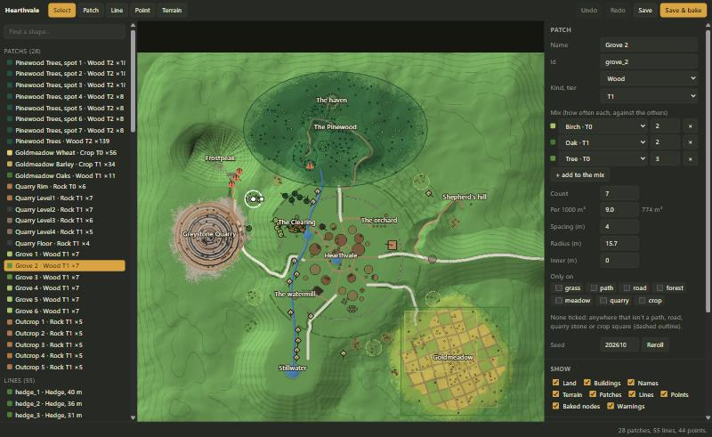

# The map editor

Asked 2026-10-30: lay out Hearthvale by hand without placing every tree in Godot. Instead of
single items, place **gatherable patches of a kind and tier**, **lines** (hedges, walls), **single
points** (landmarks) and **terrain shapes**, in a lightweight editor. Branch `map-editor` off
`main` (with the world pass merged in, 2026-10-30).

## Picked (2026-10-30)

- **A browser page**, not Godot: `tools/map_editor/`, served by a small local Python server
  (`serve.py`, localhost only) so Save can write into the repo and run the bake.
- **All four brushes:** patches, lines, points, terrain shapes.
- **Import first:** today's world is converted into editor shapes, so you start from what's there
  and reshape it.
- **Bake on save:** a headless Godot script turns the layout into a scene, like `country.tscn`
  today: the same nodes every run, and the diff readable in git.

## As built (2026-10-30)

All six phases on `map-editor`, one commit each. 

- **Run it:** `python tools/map_editor/serve.py`, open http://127.0.0.1:8765/. Tools: Select (1),
  Patch (2), Line (3), Point (4), Terrain (5). Save writes `data/layout/hearthvale.json` (one shape
  a line); Save & bake runs `tools/bake_layout.gd` (~15 s), or, when the terrain shapes changed,
  the terrain generator, `tools/export_map.gd` and the bake (~75 s).
- **The import** (`tools/import_layout.gd`, run once) gave 28 patches (the Pinewood as one big
  patch plus its 7 glade and trail spots, Goldmeadow's wheat, barley and oaks, the quarry's six
  rings, 6 groves, 5 outcrops), 55 lines (the country's hedges and walls) and 44 points (the lone
  oak, the creek's bank plants, the standing stone, shrine, bench, ruined farmstead, and the
  clearing's hand-placed trees and rocks with their old save ids). It bakes 456 gatherables.
  `place_country.gd`, `country.tscn` and the biomes' NodeSpawners are gone.
- **The bake** reuses NodeSpawner (now able to fill a polygon) in the running world, then writes
  fresh copies of what it placed, trimmed to transform and save id, so the gatherable scenes keep
  their tuning; no `unique_id`s, so a re-bake only diffs what moved.
- **Terrain shapes** go on before the generator's relax pass, which still eases anything steeper
  than ~24°: a hill has to be wide for its height (the panel says how steep its sides are).
- **Checks:** `tools/test_layout.gd` (catalog loads, shapes whole, bake in step with the layout,
  save ids unique); `test_quarry`, `test_worlds`, `test_paths`, `test_creek`, `test_ore_wall` pass.
- Open items: docs/TODO.md, "The map editor".

## How it fits together

```
data/layout/hearthvale.json   <- the editor reads and writes this (the source of truth)
data/layout/catalog.json      <- what each brush can place (kind + tier -> scenes, lines, props)
        |
        | tools/bake_layout.gd (headless, run by serve.py on save)
        v
scenes/layout.tscn            <- the baked gatherables, lines and points (main.tscn instances it)
terrain_data/ + world_roads.gd <- only when the terrain layer changed (generator reads the layout)
```

The village, its buildings and fixtures, and the places (watermill, orchard, haven...) stay in
`main.tscn` as now: the editor draws them read-only so you lay out round them.

## The brushes

- **Patch** (a polygon or a circle): kind (wood, stone, ore, crop), tier 0-3, density, optional
  mix. The catalog maps kind + tier to scenes: wood T0 = tree, T1 = oak, T2 = pine (+ birch mix);
  stone T0 = rock, T1 = iron/coal, T2 = gold/crystal; crop T0 = wheat, T1 = barley. The bake
  scatters them inside with the NodeSpawner rules (spacing, off paths, water, steep ground), seeded
  per patch so moving one patch never reshuffles another. Each patch also says whether it brings
  its scenery (canopy, ferns, grass: the biome's SceneryScatter layers) along.
- **Line** (a polyline): hedge, stone wall, fence, tree row. Gaps you leave in the line are gates.
  Baked as `HedgeRow`s, like the fields today.
- **Point:** one thing from the catalog: a lone oak, standing stone, shrine, bench, lamp,
  signpost, a single gatherable.
- **Terrain:** flats (a target height, soft edge), hills and hollows (raise / lower), ponds (dug to
  the water level, a WaterBody added), roads and paths (a polyline the generator follows instead
  of routing its own). Saving with terrain changes regenerates the land (about a minute), then
  re-bakes the rest onto the new ground.

## The page

Top-down Hearthvale (the generator's `--preview` picture, shaded by height) with overlays: roads,
water, biome borders, the village and places (locked). Pan and zoom, a layer list (terrain,
patches, lines, points; hide or lock each), select / move / reshape / delete, undo, and a
properties panel for the selected shape. After a bake the baked nodes show as dots, and the bake's
warnings (nodes that didn't fit, a line crossing a road, a point on steep ground) are listed and
clickable.

## Phases

1. **Layout file and bake, no editor yet.** The JSON format, the catalog, `tools/bake_layout.gd`
   writing `scenes/layout.tscn`, and `tools/import_layout.gd` turning the biomes' NodeSpawners and
   `country.tscn` (groves, outcrops, hedge rows, oaks, the old things) into layout shapes. The
   imported world bakes back close to how it is now; the old spawners and `place_country.gd` are
   retired.
2. **The page and server:** the map picture, overlays, pan / zoom, layers, select / move / delete,
   undo, Save -> bake -> show baked dots and warnings.
3. **Patches:** draw polygons and circles, kind / tier / density / mix / scenery.
4. **Lines and points.**
5. **Terrain shapes:** the generator reads the terrain layer (flats, hills, ponds, roads);
   today's hard-coded shapes in `generate_test_terrain.gd` and `WorldMap` move into the layout
   where they can.
6. **Checks:** a headless test (bake is deterministic, every catalog scene loads, imported world
   matches today's node counts within a margin), `audit_world.gd` passes, screenshots.

## Things to know

- Gatherables get save ids from their patch (`<patch id>_<n>`): reshaping a patch resets its
  nodes' saved state (depleted, regrowing). Fine while playtesting.
- Ore walls need a rock face to stand against, so they stay on the quarry's rings (and any cliff
  a terrain shape makes); they aren't a free line brush.
- Not in scope: placing buildings or the places themselves, sculpting by brush stroke (see
  [terrain-detail.md](terrain-detail.md)).
