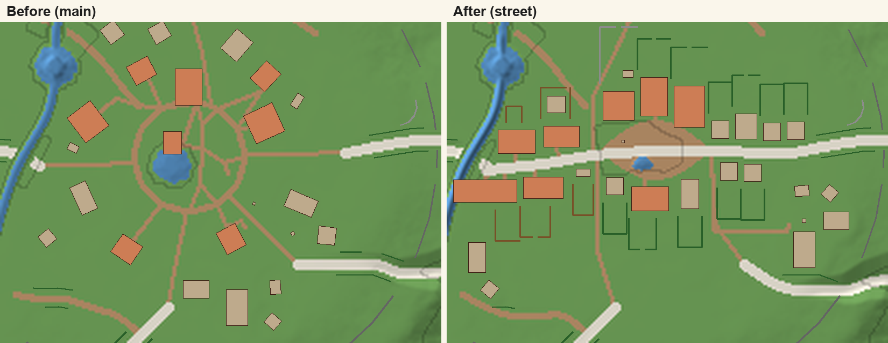

# The village street

Asked 2026-11-01: the village needs some structure. Today the buildings sit in a loose ring
round the green, each turned its own way, the lanes cross the green like a spiderweb, and none of
the roads reaches the middle. And the villagers roam: each has one work spot by their door, and
half their daytime picks send them to their door or out to the green, so they spend much of the
day walking back and forth.

## Picked (2026-11-01)

- **A street village**, not a green village or a crossroads. One main street west to east,
  following the quarry road into the east road, about 140 m long with one gentle bend.
- **Tight rows:** buildings 2–5 m apart behind small front gardens, each with a hedged plot about
  18 m deep running back from it.
- **The street widens into the market place** in the middle (about 50 m long, up to 25 m across):
  the pond, the pump, the market stall. The green becomes this paved lens; no separate square.
- **Zoning:** craft at the west end (smithy, woodcutter, timber yard, by the creek and the quarry
  road), civic in the middle (town hall, tavern, baker, chapel on the market place), farm at the
  east end (barn, stable, granary, cart shed and dovecote round a farmyard, turning toward the fields).
- **Your home:** on the street, the last house west of the market, with the biggest plot behind it
  as your garden (the woodshed and the kennel; room for veg beds and trophies later).
- **More empty cottages:** four more copies of the empty cottage, turned and mirrored so they don't
  read as copies, fill the rows; a few gaps stay as gates and alleys to the back plots.
- **Side roads:** the north road and the lake road meet the street at the market's west end; the
  fields road at its east end.
- **Work yards (everyone with a job gets a place to work):**
  - **Open to the street:** the smith's and woodcutter's beside their workshops, the baker's beside
    the bakery on the market place.
  - **Where the job is:** the fisher's at the creek (a jetty and a drying rack); the prospector's
    between her cottage and the ore store, sorting ore.
  - **The mayor** works the market edge in front of the hall (the steps, the noticeboard). **Maud**
    works out front of the tavern (wiping the tables, sweeping the step).
- **Work hours stay in the yard:** a villager moves between their own 3–4 stations, doing a
  different motion at each, with now and then a step to their own door. No trips to the green until
  work ends at dusk; the evenings (benches, strolls, the tavern) stay as they are.

The sketch is a guide, not the layout. Every spot gets checked again in the editor (the creek,
slopes, roads across pads). Its sizes are real: footprints from `world.json`'s anchors.

## What it touches

- `data/layout/hearthvale.json`: anchors (every building and fixture moves, four new cottages),
  walkways (the old ring and spiderweb go; the street's footways and each door's step join it),
  hedges and fences for the plots, props for the yards and gardens.
- `scenes/main.tscn`: four new `Village/Fixtures/EmptyCottage3..6`, each yard's stations.
- `scripts/world_map.gd` `ROADS`: the main street as a road; the village ends of the quarry, east,
  north, lake and fields roads moved to meet it (`VILLAGE_PATH` and `EAST_ROAD` are fixed control
  points today and don't follow the green).
- The green's contents: `Village/Green` (benches, lamps, crates, the pond, the four spots of
  Rosa's, Edda's, the fisher's and the woodcutter's) and `VillageDecor`'s offsets (noticeboard,
  market stall, well, fountain, planters, baskets, bunting, weathervane, painted cart) are laid out
  for a round green 40 m across. They get new spots inside the lens.
- `scripts/villager.gd` `_pick_spot()` and the work motions; `scripts/building.gd` `work_spot()`.
- The terrain: pads levelled, lanes painted, the village pond dug where the green puts it
  (the editor's Save & bake regenerates it).

## Phases

Branch `street` off `main`, one commit a phase.

1. **Props to pick.** Candidates on a page for each yard's stations: forge, anvil, quench barrel,
   tool rack, chopping block, woodpile, sawhorse, fish-drying rack, jetty, gutting table, bread
   oven, dough table, ore-sorting table, ore heap. CC0 packs first, then what we already have
   (crates, barrels, cart, hay). You pick, then they go in the catalog as props.
   **Done 2026-11-01:** 67 candidates from four CC0 packs on a pick page, 21 stations picked.
   `tools/blender/yard_kit.py` writes the 19 pieces to `models/village/yard/` (3.2 MB), all in the
   catalog as props: forge (ours, palette-painted, its embers a `LampEmbers` mesh that glows after
   dark), anvil on a log, quench bucket, grindstone, iron-bound crate, chopping log, woodpile,
   workbench (sorting table and saw bench both), axe, jetty deck (2 × 4 m sections), fish-drying
   rack, gutting table, fish, long table (Rosa's dough table and Maud's), flour sack, firewood, ore
   heap, wooden tub, scroll. KayKit's and Kenney's wood is a warmer orange than the village's:
   recolour if it stands out once placed. `test_layout` loads them all.
2. **The street and the market place.** The main street in `ROADS` and the other roads' village ends
   moved to meet it. The green reshaped into the lens: its benches, lamps, crates, pond and spots,
   and `VillageDecor`'s offsets, re-spotted inside it, with the pump and the market stall on it.
   `test_green.gd` updated for the new spots. Nothing else moves yet.
3. **The buildings on the street.** Every anchor to its place in the rows, facing the street;
   the four new cottages; the farmyard. Walkways redrawn: a footway along each side of the street,
   each door's step, gates into the plots. Terrain regenerated; the editor's warnings and
   `audit_world.gd` clean (nothing overlapping, floating, in the creek or on a slope). Before that,
   check the save: anything stored by position (built decorations, dropped items, the dog's spot)
   that would end up in the wrong place.
   **Phases 2 and 3 done together 2026-11-01** (the green and the buildings had to move at once):
   - `WorldMap.MAIN_STREET` is the first road in `ROADS` (a fixed line, quarry road to road east);
     `MARKET_LENGTH` 52 m, `MARKET_HALF_WIDTH` 14 m, `market_half_width()`, `in_market()`. The
     generator paves the market instead of the ring; its road lanes are now the north, lake and
     fields roads' ends in to the street (`GREEN_HOME` (137, 125), where the green stands).
   - The green at (137, 125), unturned: its benches, lamps, crates, Rosa's and Edda's Square spots
     and the benches' seats inside the lens; the pond 3.5 m (was 9) at (-6, 6), its water, volume
     and dressing to match. `VillageDecor`: the noticeboard on the north side, the market stall
     south-east, well, fountain, planters, baskets, bunting and cart re-spotted. The trader parks
     at the market's east end, coming down the street.
   - Every building and fixture re-anchored along the street (positions worked out in a sketch
     script, from footprints, so each front is on the street's or the market's edge); four more
     empty cottages (`Village/Fixtures/EmptyCottage3..6`, the second's garden, mirrored on two).
     The washhouse went behind the fisher, by the creek; the farmyard round (206, 158).
   - Walkways: the street, a stroll round the market (2 m inside its edge), two across it, and the
     north, lake and fields lanes. Three old hedges the barn and ruined cottage now stood on, gone.
   - Terrain regenerated: no warnings, every pad within 2 cm of level. `test_green` and
     `test_terrain_follows` updated for the green's new place and spots.
   - The save: only the player's position is stored by place. `Player.WORLD_VERSION` 3, so an older
     save starts by your home instead of perhaps inside a building that moved.
4. **Plots and gardens.** Hedges, fences and low walls round each back plot, with gates; your home's
   garden (woodshed, kennel, room to grow); a little clutter in each (barrels, a cart, veg beds,
   washing). The empty cottages get gardens too, so they look lived-in, or nearly.
   **Done 2026-11-01:** every street house has a plot about 18 m deep behind it (layout lines
   `plot_*`): field fences for the craft end (smithy, woodcutter, fisher, prospector, ore store),
   hedges for the market and the cottages, a low stone wall round your home's (30 m deep: the
   woodshed, two veg beds, flowers, a bench). Each back side has a gate gap in the middle (the
   woodcutter's where the path from the clearing comes in; narrow plots have none: the field fence
   comes in 5 m lengths). The sides start 3.5 m behind the house. The smithy's plot is shorter (11 m)
   and stops short of the creek. Two or three things in each plot (`plot_*` points: barrels,
   crates, a bale, veg beds, cabbages, pumpkins, flowers). The washhouse moved south of the
   fisher's plot, down by the creek; the timber yard to the middle of the woodcutter's.
5. **Work yards.** Each worker's stations as markers in their building's frame (so they move
   with it), each with the motion to do there. `_pick_spot()` by day: their own stations and now
   and then their door, never the green. The fisher's jetty and the prospector's sorting table out
   where they are. The mayor's and Maud's spots. **To settle while building it:** whether a tier adds
   a station (the yard filling out as the building grows, as `Work1..3` move up with the tier today)
   or all the stations are there from the start; default: a tier adds one.
6. **New motions.** Where today's six (chop, hammer, fish, orate, tend, wipe) don't fit: dunking at
   the quench barrel, kneading, carrying, sorting, sweeping. Reuse first, add only what's missing.
   **Phases 5 and 6 done 2026-11-01:**
   - `scripts/work_yards.gd` (`WorkYards.YARDS`): each worker's props and stations in the building's
     frame; `Building._ready` builds them under a `Yard` node, `Building.stations()` lists the ones
     open at the shown tier (a tier adds one, as `Work1..3` did). The smith: forge, anvil, quench
     bucket, grindstone (4 stations). The woodcutter: chopping log, woodpile, saw bench. Ollie: a
     jetty on the creek 20 m west of his hut (its own footpath from the street), a gutting table and
     the drying rack. Edda: the sorting table, the ore heap, a tub. Rosa: the dough table, the flour,
     the oven's wood. The mayor: the hall's steps, the noticeboard, the market. Maud: a table out
     front and the step (the bar is still hers in the evening: `work_spot()`).
   - `Villager`: in work hours with a yard, `_pick_spot()` picks another station (a 15% chance of
     their own door instead), never the bench or the green; the motion is the station's.
   - Seven new motions, on the end of `Villager.Work`: STOKE (the forge), DUNK (quench bucket, tub),
     GRIND (the grindstone, a foot on the treadle), SAW, KNEAD, SWEEP, SORT. TEND, CHOP, HAMMER,
     FISH, ORATE and WIPE reused for the rest.
   - Paths: the market's furniture moved off the stroll and the crossings (lamps, stall, crates,
     benches, noticeboard, planters, well), the fields lane past the cottages' back hedges. New game:
     you start at your home's door, facing the market.
   - Tests: all 41 pass. `test_paths` prints a blocked link's points; `test_projects` wants the
     noticeboard on the market (8–20 m from its middle); `test_dog` stands you across the market
     in the morning; `test_day` checks everyone's home at 21:48 (was 21:30: from a market bench to
     the west end is ~90 m now). `audit_world.gd` checks each yard station's facing too.
   - Audit: no CLIP, nothing new floating or buried. Three FACE findings are the probe, not the
     stations: Rosa's firewood (19 cm high), Edda's tub (hollow) and Ollie's fish rack (an A-frame,
     open at chest height).
   **Phase 7 done 2026-11-01:** all 41 tests pass; the audit as above; the map before and after
   below. Then, with a game window (2026-11-01): `tools/street_shots.gd` (18 views: the street end
   to end, the market both ways, the air, each yard at work, the jetty, the plots, your garden, the
   farmyard) in `docs/images/street/`; `perf_probe.gd`'s three village spots moved onto the street.
   1920x1080, nothing else on the GPU (the old green's reference was 92.8 fps, 10.8 ms, p95 13.4):

   | spot | fps | ms | p95 | GPU ms | draws | prims |
   |---|---|---|---|---|---|---|
   | village: the market from its south side | 91.0 | 10.99 | 14.26 | 9.46 | 2392 | 4.07 M |
   | village at dusk: down the street from the west end | 90.2 | 11.09 | 15.78 | 8.24 | 2992 | 3.31 M |
   | square: from the market, west down the street | 113.3 | 8.83 | 11.19 | 6.88 | 1734 | 1.97 M |

   Unplayed.

7. **Check.** The tests that touch it (`test_green`, `test_walkways`, `test_anchors`, the terrain
   follows test), `audit_world.gd`, the map before and after, headless screenshots down the street
   and of each yard at work, frame times walking the street. Then it's yours to play.

## Not in this plan

- The rest of the map (the road loop, the creek, the empty east, the border): its own grill later.
- What the empty cottages become (new villagers, project unlocks).
